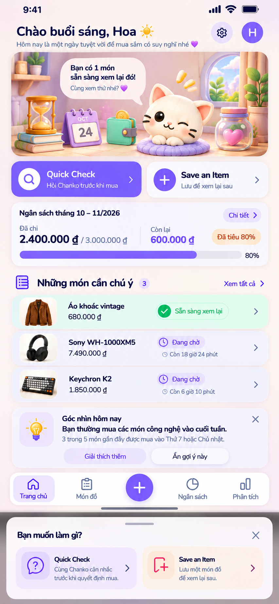

# Chanko Home — bàn giao v3 với Living Room assets

Ngày 24/10/2026. Sáu PNG tái tạo đã có trong gói. Mở 11-ASSET-DELIVERY trước các ghi chú thiếu asset lịch sử.

---

> **Cập nhật v3 — asset đã có:** Sáu PNG Living Room tái tạo đã được bàn giao tại `assets/living-room/`: background, mèo/đệm, hourglass/books, calendar trống, wallet và jar tim. Các câu “asset thiếu” trong tài liệu v2 dưới đây được thay thế bởi cập nhật này đối với sáu asset đó. Layer/source 3D gốc, license/provenance fonts cũ, TECH alignment và runtime/design QA vẫn chưa được xác nhận. Dùng PNG mới, không dùng mèo khoanh tay legacy. Mở `assets/living-room/PREVIEW.html` và đọc `11-ASSET-DELIVERY.md`.

# Chanko Home — Compose implementation handoff

Ngày đóng gói: 24/10/2026 • Ngôn ngữ tài liệu: tiếng Việt • Phiên bản: 3.0 — image-aligned + generated assets

Bắt đầu tại [START-HERE](START-HERE.md). Đây là bộ tài liệu triển khai, không phải bản code đã tích hợp. Không xác nhận tình trạng repository, API hay build hiện tại. Không sửa code ứng dụng.

**Ảnh chuẩn:** [Home người dùng đã chốt](references/approved-home-user-reference.png). **v2 thay thế v1 về visual.**

## Nội dung

- [Visual reference và mapping theo ảnh](00-VISUAL-REFERENCE.md).

- [Approved UX spec](01-APPROVED-UX-SPEC.md): cấu trúc được chốt và giới hạn nguồn chứng cứ.
- [Component tree & contracts](02-COMPONENT-CONTRACTS.md): state, event, điều kiện và ownership.
- [Design tokens](03-DESIGN-TOKENS.md): Candy Pop/Nunito, phân biệt giá trị tham chiếu và đã duyệt.
- [Resource manifest](04-RESOURCE-MANIFEST.md), [manifest máy đọc](resource-manifest.json), [asset briefs](assets/ASSET-BRIEFS.md).
- [Roadmap Phase 0–11](05-ROADMAP.md), [prompts theo phase](prompts/README.md).
- [Fake-data scenarios](06-FAKE-DATA.md), [fixtures JSON](fixtures/home-scenarios.json).
- [Previews/tests](07-PREVIEWS-TESTS.md), [acceptance](08-ACCEPTANCE.md).
- [Pending TECH alignment](09-PENDING-TECH-ALIGNMENT.md), [traceability](10-TRACEABILITY.md).
- `references/`: ảnh cũ và ghi chú nguồn. `assets/`: asset thực có, không phải đầy đủ scene mới.
- `CHANKO-HOME-COMPLETE.md`: bản gộp Markdown để đọc một file.
- `SHA256SUMS.txt`: checksum mọi file nội dung (không chứa chính nó).

Tên file trong bộ ZIP là đường dẫn thật của gói này. Tên Compose là hợp đồng đề xuất, không khẳng định chúng tồn tại trong repo.

- [Asset delivery v3](11-ASSET-DELIVERY.md) — sáu PNG mới và preview.


---

> **Cập nhật v3 — asset đã có:** Sáu PNG Living Room tái tạo đã được bàn giao tại `assets/living-room/`: background, mèo/đệm, hourglass/books, calendar trống, wallet và jar tim. Các câu “asset thiếu” trong tài liệu v2 dưới đây được thay thế bởi cập nhật này đối với sáu asset đó. Layer/source 3D gốc, license/provenance fonts cũ, TECH alignment và runtime/design QA vẫn chưa được xác nhận. Dùng PNG mới, không dùng mèo khoanh tay legacy. Mở `assets/living-room/PREVIEW.html` và đọc `11-ASSET-DELIVERY.md`.

# START HERE — v2, bám ảnh người dùng

**Nguồn visual chuẩn duy nhất cho Home mới: [ảnh người dùng gửi](references/approved-home-user-reference.png).** Đọc [visual mapping](00-VISUAL-REFERENCE.md), rồi approved UX spec và contracts trước khi implement.

## Thứ tự ưu tiên

1. Chỉ dẫn “làm đúng theo ảnh kia” và ảnh đính kèm của người dùng ngày 24/10/2026.
2. Quy tắc đã chốt: decisions tối đa 3, Ready → Waiting → Considering → Saved; Observation/Draft optional; bốn tab với + trung tâm mở Global Quick Action; contextual sheets.
3. Hình thức theo ảnh: Header có dòng phụ, Living Room có dialogue bên trong, hai thẻ action, budget ngang, ba decision row, Observation và bottom nav/sheet.
4. Token v5 cũ chỉ là giá trị khởi đầu. Không dùng ảnh calendar-led v5 cũ làm chuẩn bố cục hoặc pose mèo mới.

## Cách dùng

Phase 0 mapping vào repo được giao, chốt business contracts còn mở. Phase 1–11 triển khai theo component; Phase 4 là dialogue NẰM TRONG scene đã dựng Phase 3, không là row độc lập. Prompt mỗi phase đã được cập nhật. Đối chiếu ảnh ở từng review visual, không chỉ đọc text mô tả.

## Những gì có / còn thiếu

Có ảnh chuẩn gốc được copy nguyên byte vào gói, tài liệu theo ảnh, fixture và 12 prompt. Scene mới chưa có layer/source hoặc asset rời final; mèo legacy khoanh tay khác pose trong ảnh và không được dùng làm final. Hourglass/Calendar/Wallet/Pause Jar chưa có file rời đúng ảnh. Font/asset license cần xác nhận trước phát hành.

Đây là tài liệu triển khai và tài nguyên tham chiếu, không phải code đã tích hợp. Không sửa repository hay synced sources. Không xác nhận tình trạng build/phase app. Không dùng emulator/AVD/VM; runtime chỉ thiết bị thật, nếu chưa có thì báo unverified. Không thêm launcher riêng.


---

# Asset delivery v3

Đủ sáu raster để bắt đầu dựng Living Room theo ảnh bằng file riêng: [asset pack README](assets/living-room/README.md), [preview ghép lớp](assets/living-room/PREVIEW.html), [manifest](assets/living-room/asset-manifest.json), [scene layout](assets/living-room/scene-layout.json), [prompt set](assets/living-room/generation-prompts.json).

Các ảnh được tạo bằng built-in image_gen với ảnh Home chuẩn làm reference, không phải layer gốc trích chính xác. Đã chọn lại mèo để bỏ quầng sáng lớn từ bản đầu; giữ bản nguồn PNG, không xử lý/cắt ảnh bằng Python. Năm sprite RGBA có pixel alpha=0 và alpha=255, background RGB. Glass có alpha nhưng hiệu ứng xuyên kính phải kiểm tra trên scene thật. Kiểm tra cấu trúc file/alpha không thay thế visual review runtime.

Có thể tiến hành Phase 3/4 với asset thật thay placeholder. Chưa gọi app pixel-perfect, chưa có runtime/build test; dp layout/hit targets/date overlay vẫn cần tinh chỉnh theo previews. Các icon UI thông dụng dựng vector/Compose theo cùng style, không yêu cầu PNG; icon bulb Observation có thể dùng vector/Compose có cùng treatment để triển khai. TECH contracts/persistence/navigation theo pending alignment.

v3 thay thế báo thiếu sáu PNG trong v2. Không thay đổi approved layout hoặc thứ tự/component invariants. Không sửa repo/code hoặc sources synced. Layer/source 3D gốc và quyền dùng tài nguyên tham chiếu/font vẫn theo pending log; file tái tạo mới có provenance generation trong prompt set.


---

> **Cập nhật v3 — asset đã có:** Sáu PNG Living Room tái tạo đã được bàn giao tại `assets/living-room/`: background, mèo/đệm, hourglass/books, calendar trống, wallet và jar tim. Các câu “asset thiếu” trong tài liệu v2 dưới đây được thay thế bởi cập nhật này đối với sáu asset đó. Layer/source 3D gốc, license/provenance fonts cũ, TECH alignment và runtime/design QA vẫn chưa được xác nhận. Dùng PNG mới, không dùng mèo khoanh tay legacy. Mở `assets/living-room/PREVIEW.html` và đọc `11-ASSET-DELIVERY.md`.

# Ảnh chuẩn và mapping visual — v2



Ảnh này được người dùng gửi trực tiếp ngày 24/10/2026 và yêu cầu “làm đúng theo ảnh kia”. Đây là chuẩn hình thức/layout. Ảnh raster không cung cấp dp/sp, layer, font metadata hoặc resource rời; các thông số kỹ thuật phải đo/chốt qua Compose previews, không tuyên bố là số đo thiết kế gốc.

## Bố cục phải tái hiện

| Vùng | Hình thức theo ảnh | Compose ownership |
|---|---|---|
| Header | “Chào buổi sáng, Hoa” + biểu tượng mặt trời; dòng phụ màu muted với tim tím; gear trong vòng lavender và avatar tím bên phải | HomeHeader gồm GreetingRow, Subtitle, SettingsAction, AvatarAction |
| Living Room | Một khung bo tròn ngang; phòng pastel ấm, kệ sách/cây trái, cửa sổ vòm/cây phải; không là lịch lớn | CompactLivingRoom chứa SceneArtwork và interactive overlay |
| Mèo | Mèo trắng 3D nằm chống cằm trên đệm lavender, mắt mở/nháy, vị trí giữa-phải | ChankoCatArtwork; không dùng mèo khoanh tay legacy làm final |
| Hourglass | Đồng hồ cát vàng trên chồng sách, phía dưới-trái | RoomProp(Hourglass) |
| Calendar | Lịch bàn tím bên phải đồng hồ cát, phía dưới-trái | RoomProp(Calendar), ngày/tháng dynamic |
| Wallet | Ví xanh mint giữa Calendar và mèo | RoomProp(Wallet) |
| Pause Jar | Hũ thủy tinh nắp hồng, tim hồng bên trong, phía phải mèo | RoomProp(PauseJar); không tự đổi thành hũ tiền |
| Dialogue | Bubble cream góc trên-trái trong khung scene, đuôi hướng về mèo; hai đoạn với trọng lượng chữ khác nhau | ChankoDialogue overlay là con của CompactLivingRoom |
| Quick actions | Hai thẻ cạnh nhau; Quick Check tím, icon search trong vòng trắng; Save an Item nền sáng, + trong vòng tím; subtitle và chevron | QuickActionsRow |
| Budget | Card sáng; title chu kỳ trái, pill “Chi tiết” phải; spent/limit trái, remaining phải, badge cam; progress dưới và % ở cuối | BudgetCard |
| Decisions heading | Icon checklist tím, “Những món cần chú ý”, count chip, “Xem tất cả” bên phải | YourDecisionsSection header |
| Decision rows | Thumbnail trái, tên/giá giữa, status pill và countdown ở vùng phải, chevron ngoài cùng; ready mint, waiting lavender sáng | DecisionRow; tối đa 3 |
| Observation | Icon bóng đèn trong tile lavender; title + close; nhận xét bold + evidence muted; hai pill “Giải thích thêm”, “Ẩn gợi ý này” | ObservationCard, action theo capability |
| Nav | Thanh trắng bo tròn; Trang chủ, Món đồ, + tím lớn, Ngân sách, Phân tích; selected Home tile lavender | ChankoBottomNavigation |
| Global sheet | Scrim, top rounded sheet, drag handle, title “Bạn muốn làm gì?”, close phải; hai action tile Quick Check/Save an Item | GlobalQuickActionSheet |

## Điều cần hiểu đúng khi implement

- Ảnh trình bày cả Home và sheet như một composite để minh họa hai trạng thái. App render sheet bằng modal overlay trên Home với scrim; không nối screenshot sheet thành nội dung dưới nav hoặc làm trang dài thứ hai.
- Bubble không là section thứ ba sau scene. Thứ tự content: Header → Living Room chứa Dialogue → QuickActions → Budget → Decisions → optional Observation/Draft.
- Status/timer/money/count/tiêu đề/ngày tháng là dữ liệu động; con số trong ảnh là fixture. `24 OCT`, budget tháng 10–11/2026 và ba món không được hardcode production.
- Giữ wording tiếng Anh “Quick Check”, “Save an Item” và các nhãn Việt như ảnh làm baseline copy. Localization ngoài baseline chờ xác nhận; không tự đổi nhãn visual thành “Kiểm tra nhanh” trong bản bám ảnh.
- Không gắn hành động mua hàng lên biểu cảm mèo hoặc màu ready. Priority/rank và max 3 giữ đúng request trước dù ảnh chỉ minh họa Ready/Waiting.
- Draft không có trong ảnh; chỉ render khi có draft thật theo quy tắc optional, không chèn card demo vào mặc định.
- Observation trong ảnh có thể hiện khi dữ liệu nguồn hỗ trợ. Không tự tính “3 trong 5” nếu chưa có observation thật. Close/Hide/Explain cần contract riêng, không phải ba nút chỉ mở cùng một flow.

## Responsive giữ thiết kế

Baseline mobile giữ tỉ lệ/thứ tự tương đối trong ảnh: gutter đều, scene ngang, action cards cạnh nhau, budget và decision rows rộng bằng content. Scene không stretch ảnh toàn màn hình. Background decorative không có semantics; text và interaction là UI thật. Tách các prop nếu cần ngày động/hit target độc lập, hoặc dùng background không chứa prop rồi overlay; không chồng asset trùng lên composite có sẵn.

Ở 320dp hoặc font 1.5–2.0, cho text/action/budget/status reflow để đọc được. Reflow được phép khi cần accessibility nhưng không chuyển dialogue xuống thành section khác, đổi pose mèo, bỏ prop hoặc đổi semantic action. Scene container có thể tăng chiều cao/chừa vùng bubble theo nội dung; tránh fixed pixel offset làm bubble che mặt mèo/prop.

Target tương tác có bounds Compose/semantics độc lập và được kiểm tra overlay bằng debug preview; không render debug bounds trong app. Không gán click theo tọa độ ảnh tùy ý. Tối thiểu 48dp khi có thể, không giao nhau. Mỗi prop chỉ mở context sau khi mapping TECH đã chốt.

## Sai khác v1 đã sửa

v1 dựa mô tả và ảnh calendar-led cũ, đặt dialogue thành section riêng và chưa có ảnh chuẩn mới. v2 đưa ảnh người dùng vào nguồn chuẩn, đặt dialogue trong scene, chốt pose mèo/đệm tím/vị trí bốn prop, Header subtitle, Budget detail pill, Observation actions và Global sheet theo ảnh. v1 bị thay thế cho triển khai visual.


---

> **Cập nhật v3 — asset đã có:** Sáu PNG Living Room tái tạo đã được bàn giao tại `assets/living-room/`: background, mèo/đệm, hourglass/books, calendar trống, wallet và jar tim. Các câu “asset thiếu” trong tài liệu v2 dưới đây được thay thế bởi cập nhật này đối với sáu asset đó. Layer/source 3D gốc, license/provenance fonts cũ, TECH alignment và runtime/design QA vẫn chưa được xác nhận. Dùng PNG mới, không dùng mèo khoanh tay legacy. Mở `assets/living-room/PREVIEW.html` và đọc `11-ASSET-DELIVERY.md`.

# Approved UX spec — theo ảnh người dùng

Nguồn chuẩn: [ảnh Home đã chốt](references/approved-home-user-reference.png), [mapping từng vùng](00-VISUAL-REFERENCE.md). Phiên bản này thay thế bố cục v1. Ảnh v5 calendar-led trong references là nguồn lịch sử, không dùng làm chuẩn layout mới.

## 1. Header

Greeting lớn đậm bên trái, biểu tượng mặt trời cạnh lời chào; dòng phụ muted bên dưới như ảnh. Gear trong vòng lavender và avatar tròn tím phía phải. Giữ typography Nunito, chữ dark ink, tim tím trang trí. Tên/ngày/chào động từ state; mặt trời/tim không thay text quan trọng. Gear/profile có label và touch target riêng. Tên dài/font lớn được reflow, không che nút.

## 2. Compact Living Room, chứa Chanko Dialogue

Một scene phòng pastel 3D bo góc, nằm ngay dưới Header. Mèo trắng nằm chống cằm trên đệm tím giữa-phải, không phải mèo khoanh tay từ asset legacy. Hourglass vàng trên sách ở trái; Calendar bàn tím bên cạnh; Wallet mint giữa lịch và mèo; Pause Jar thủy tinh tim hồng ở phải. Kệ/cây/cửa sổ tạo background như ảnh. Không thay bằng dashboard icon/card hoặc hero lịch.

Bubble cream nằm góc trên-trái của scene, đuôi hướng mèo; text thật hai mức nhấn, baseline “Bạn có 1 món sẵn sàng xem lại đó!” / “Cùng xem thử nhé? 💜”. Đây là fixture, count và message phải khớp state; không bịa số món. Dialogue là child/overlay của Living Room, không là section dưới scene. Cho scene tăng chiều cao/chừa chỗ khi text lớn; bubble không che target/face. Message absent thì bỏ bubble và bảo toàn composition; rule message/fallback chờ TECH/product.

Scene raster chỉ là artwork, không bake text động. Calendar tháng/ngày lấy từ date state đã chốt; `OCT 24` trong ảnh là minh họa. Mapping prop đề xuất: Hourglass → waiting context, Calendar → calendar context, Wallet → budget context, Pause Jar → pause context; nghĩa nghiệp vụ và sheet final chờ TECH. Pause Jar theo visual là hũ tim, không suy diễn số tiền tiết kiệm/reward.

## 3. Quick Check + Save an Item

Hai card ngang dưới scene. Trái tím gradient, icon search trong vòng trắng, title “Quick Check”, subtitle “Hỏi Chanko trước khi mua”, chevron trắng. Phải nền sáng lavender, + trắng trong vòng tím, title “Save an Item”, subtitle “Lưu để xem lại sau”, chevron muted. Giữ đúng hierarchy/icon/card treatment trong ảnh. Font lớn/màn hẹp có thể xếp dọc.

Hai intent độc lập. Bấm không tự save hay tự đánh giá; route/flow/form và validation do TECH chốt. Loading/disabled phải có semantics, không ảnh hưởng khả năng chuyển tab ngoài capability cần thiết.

## 4. Budget

Card sáng bo tròn. Title “Ngân sách tháng 10 – 11/2026” là ví dụ cycle; “Chi tiết” pill + chevron góc phải. Hàng số: “Đã chi” và spent lớn / limit nhỏ hơn bên trái; divider; “Còn lại” tím bên phải và badge cam “Đã tiêu 80%”. Dưới cùng progress tím với nhãn 80% ngoài track như ảnh.

Tiền/cycle/% lấy từ state, không hardcode. VND fixture: limit 3.000.000 ₫, spent 2.400.000 ₫, remaining 600.000 ₫. Unknown không thành 0; limit 0/null không chia cho 0; remaining âm hiển thị đúng; visual progress clamp 0..1 nhưng nhãn thực có thể >100%. Policy badge khi unknown/negative chờ TECH; không invent text. Detail mở budget context/route theo decision log, không tự thêm calendar hero.

## 5. Your Decisions — “Những món cần chú ý”

Heading có checklist tím, count chip và “Xem tất cả”. Rows theo ảnh: thumbnail trái; title/price; status pill vùng phải; Waiting có clock + remaining dưới pill; chevron ngoài cùng. Ready dùng mint, Waiting lavender sáng. Considering/Saved chưa có style riêng trong ảnh: giữ cùng family, bổ sung nhãn chữ rõ theo product, không tự gọi style mở rộng là đã có trong ảnh.

Tối đa 3 item, ưu tiên Ready → Waiting → Considering → Saved. Sau canonicalization theo TECH, stable sort priority rồi take(3), giữ upstream order trong nhóm. Input phải đảm bảo candidate toàn cục; không rank trên trang tùy ý có thể bỏ sót Ready. Count chip total/visible semantics chờ TECH, nhưng không ghi 3 nếu thực tế rỗng/lỗi. Row/tap CTA không double-navigate. Ready không là lời khuyên nên mua; Waiting vẫn mở được. Countdown về 0 không tự đổi domain status hoặc tự mua.

Empty có lời trung tính và Save entry; loading/error không giả empty. Unknown price không là 0. Thumbnail fallback khi ảnh thiếu. “Xem tất cả” route/filter cần TECH chốt.

## 6. Optional Observation / Draft

Observation theo ảnh: tile bóng đèn trái, title “Góc nhìn hôm nay”, X góc phải; nhận xét bold và evidence muted; hai pill “Giải thích thêm”, “Ẩn gợi ý này”. Nội dung “Bạn thường mua các món công nghệ vào cuối tuần” / “3 trong 5…” chỉ là fixture, không được suy diễn từ dữ liệu không có. Explain, Hide và X có intent riêng, behavior/persistence chờ TECH. Không gán tất cả thành cùng một click.

Chỉ render khi có observation thật. Draft không hiện trong ảnh; chỉ thêm nếu có draft thật, nằm sau Observation theo hợp đồng optional, với resume đúng ID. Không có card demo/dummy mặc định; null bỏ cả spacer. Draft selection/retention/discard chưa chốt; không thêm xóa.

## 7. Bottom navigation

Thanh trắng bo tròn, bốn tab như ảnh: Trang chủ, Món đồ, Ngân sách, Phân tích. Trang chủ selected có tile lavender và icon/label tím. + lớn tím ở giữa, cân đối hai cặp tab, là action không phải tab. Mở + giữ selected tab hiện tại và mở Global Quick Action Bottom Sheet. Insets chừa nội dung cuối, bar cố định ngoài scroll.

## 8. Global Quick Action Bottom Sheet

Ảnh dưới minh họa sheet ở trạng thái mở: scrim, sheet bo góc trên, drag handle, title “Bạn muốn làm gì?”, X phải; hai tile ngang. Quick Check: icon bubble/question tím, title, mô tả “Cùng Chanko cân nhắc trước khi quyết định mua.” và chevron. Save an Item: icon bookmark/add hồng, title, mô tả “Lưu một món đồ để xem lại sau.” và chevron. Không dùng icon card Home thay cho icon sheet nếu muốn bám ảnh.

App dùng modal overlay, không đặt sheet thành block tiếp theo dưới nav như composite ảnh. Một active sheet; repeated + không stack. Back/X/gesture đóng sheet, trả focus về +; dismiss không ghi dữ liệu. Chọn tile đi flow tương ứng theo TECH, không mở hai modal chồng. Long content/font lớn/IME reflow và scroll để CTA đọc được.

## 9. Contextual sheets

Global sheet trong ảnh đã có chuẩn visual. Ảnh không cho biết nội dung chi tiết của Hourglass/Calendar/Wallet/Pause Jar/Decision sheets; cần TECH/product bổ sung, không invent field, CTA hoặc layout rồi gọi là approved. Context được typed và truyền ID đúng. Entity bị xóa khi mở sheet phải chặn mutation, báo không còn khả dụng và cho đóng.

## Responsive / state / a11y

Candy Pop/Nunito theo ảnh, không đổi visual language. Thông số dp/sp/HEX từ v5 cũ là khởi điểm đề xuất, không là số trích từ ảnh mới. Đo preview 320/393/600dp × scale 1/1.5/2; không cắt tiền/action. Header/actions/budget/rows reflow khi cần, dialogue vẫn bên trong scene. Hit target ≥48dp khi có thể, TalkBack order từ header tới scene/props/dialogue theo nghĩa rồi actions; decorative artwork không đọc lặp. Giữ text labels và selected semantics.

Loading theo section; error retry cục bộ; cache/stale/absence trung thực theo data contracts. Reduced motion dùng artwork tĩnh. Không network hoặc gọi AI từ composable. Không dùng ảnh toàn màn làm UI, không cắt text/icon/button từ PNG để giả component.


---

> **Cập nhật v3 — asset đã có:** Sáu PNG Living Room tái tạo đã được bàn giao tại `assets/living-room/`: background, mèo/đệm, hourglass/books, calendar trống, wallet và jar tim. Các câu “asset thiếu” trong tài liệu v2 dưới đây được thay thế bởi cập nhật này đối với sáu asset đó. Layer/source 3D gốc, license/provenance fonts cũ, TECH alignment và runtime/design QA vẫn chưa được xác nhận. Dùng PNG mới, không dùng mèo khoanh tay legacy. Mở `assets/living-room/PREVIEW.html` và đọc `11-ASSET-DELIVERY.md`.

# Component tree và contracts đề xuất

Tên dưới đây là logical API, không phải file path hoặc package đã có trong repository. Phase 0 mapping vào kiến trúc thực tế. Stateless component nhận state + callback; route/ViewModel xử lý dữ liệu và effect. UI không gọi repository, timer hệ thống, network hay navigation controller trực tiếp trong từng card.

```text
HomeRoute
└─ HomeScreen(HomeUiState, onAction)
   ├─ HomeHeader
   ├─ LazyColumn / HomeContent
   │  ├─ CompactLivingRoom
   │  │  ├─ ChankoCatArtwork
   │  │  ├─ RoomProp × 4 (Hourglass, Calendar, Wallet, PauseJar)
   │  │  └─ ChankoDialogue (bubble overlay trong scene)
   │  ├─ QuickActionsRow (QuickCheckEntry, SaveItemEntry)
   │  ├─ BudgetCard (BudgetAmounts, BudgetProgress)
   │  ├─ YourDecisionsSection → DecisionRow × 0..3
   │  ├─ ObservationCard? 
   │  └─ DraftResumeCard?
   ├─ ChankoBottomNavigation (4 tab + CenterAddAction)
   └─ HomeSheetHost
      ├─ GlobalQuickActionSheet
      └─ ContextualSheet (typed context, one at a time)
```

## State đề xuất, không phải domain schema

```kotlin
// Pseudocode, chưa phải đoạn drop-in hoặc API đã tồn tại.
HomeUiState(
  // dialogue được truyền vào CompactLivingRoom; không render thành row riêng
  header: HeaderUi,
  room: SectionState<LivingRoomUi>,
  dialogue: SectionState<DialogueUi?>,
  budget: SectionState<BudgetUi>,
  decisions: SectionState<List<DecisionUi>>,
  observation: ObservationUi?,
  draft: DraftUi?,
  selectedTab: TopLevelTab,
  sheet: HomeSheet?,
  capabilities: HomeCapabilities
)
SectionState<T> = Loading | Content(value: T, freshness) | Error(message, retryKey)
HomeSheet = Global | Context(kind: ContextKind, entityId: String?)
ContextKind = Hourglass | Calendar | Wallet | PauseJar | Decision
DecisionStatus = Ready | Waiting | Considering | Saved
```

`Content(emptyList())` khác Error/Loading. Optional null là không hiển thị; nếu optional cần loading/error độc lập, mở rộng SectionState thay vì null giả. Freshness gồm snapshot/asOf và stale indicator khi hợp đồng data hỗ trợ. Error text là thông điệp người dùng đọc được, không dump exception.

MoneyUi phải chứa amount chính xác và currency; implementation chọn minor units/decimal theo TECH, tuyệt đối không lấy Float làm tiền. Date/time phải phân biệt Instant với ngày địa phương, inject clock/timezone vào formatter hoặc presenter. Giá unknown không in `0 ₫`. Fixture không định nghĩa serialization production.

## Contract từng component

| Component | Input tối thiểu | Output intent | Invariant / owner |
|---|---|---|---|
| HomeHeader | greeting, subtitle, displayName?, avatar?, capabilities | SettingsTapped, ProfileTapped | fallback avatar bằng chữ; không tự fetch |
| CompactLivingRoom | scene artwork, cat asset key, 4 PropUi, dialogue state, reducedMotion | PropTapped(kind) | pose mèo nằm trên đệm tím; 4 prop đúng ảnh; dialogue trong scene, không đè target |
| RoomProp | kind, label, optional summary, enabled | PropTapped(kind) | summary unknown không = 0; disabled có lý do |
| ChankoDialogue | message?, supportingLine?, tone, optional supported CTA | DialogueActionTapped(id) | text Compose trong scene; không tự sinh copy hoặc gọi AI |
| QuickActionsRow | canQuickCheck, canSave, busy | QuickCheckTapped, SaveItemTapped | phân biệt hai intent, state loading không khóa nav |
| BudgetCard | limit?, spent?, remaining?, ratio?, cycle?, freshness | BudgetTapped, Retry(Budget) | ratio visual clamp; tiền âm/unknown chính xác |
| YourDecisionsSection | rankedVisibleItems, totalCount?, sectionState | DecisionTapped(id), ViewAllTapped, Retry(Decisions) | ≤3, stable keys=id, dedup trước rank |
| DecisionRow | id, title, image?, money?, status, countdown?, capability | DecisionTapped(id) | không tự chuyển status khi timer hết |
| ObservationCard | id, title, text, evidenceText?, supported CTAs, canDismiss | ObservationExplainTapped(id), ObservationHideTapped(id), ObservationDismissTapped(id) theo capability | absent → bỏ section/spacer; không fabricate insight |
| DraftResumeCard | id, summary, updatedLabel? | ResumeDraftTapped(id) | draft phải tồn tại; không tự discard |
| ChankoBottomNavigation | selectedTab, labels, capabilities | TabSelected(tab), AddTapped | + không phải tab; 4 selected semantics |
| HomeSheetHost | typed active sheet?, context data, busy/error | DismissSheet, SheetAction(id) | chỉ một active; không commit khi dismiss |
| GlobalQuickActionSheet | allowed entries | QuickCheckTapped, SaveItemTapped | chỉ entry được phép; back/dismiss restore focus vào + |
| ContextualSheet | kind, optional entity ID, section data | context-specific supported action | validate entity tồn tại; action chưa chốt không hiển thị |

## Event/effect ownership

- UI emit HomeAction một chiều. Route/ViewModel quyết định state; adapter điều phối navigation/effect theo conventions repo sau Phase 0.
- Open sheet là UI state có thể khôi phục theo policy; navigation là effect xử lý một lần theo lifecycle của app. Không phát điều hướng trong composition.
- Reducer đề xuất: AddTapped → Global; PropTapped → Context(kind); DecisionTapped → Context(Decision,id) nếu route này được TECH duyệt, hoặc effect mở detail đã tồn tại. Không làm cả hai.
- Khi item biến mất trong lúc sheet đang mở: hiển thị “Món đồ không còn khả dụng”, chặn thao tác ghi và cho đóng. Không crash hoặc giữ thao tác cho ID khác.
- Lặp click khi sheet active: cập nhật/giữ một sheet; quyết định sheet transition khi dirty form theo TECH, không bỏ dữ liệu âm thầm.
- Retry theo section, hủy/cancel theo lifecycle. Không triển khai polling/timer mỗi row. Presenter dùng clock chung và source status authoritative.
- Scroll restoration, process death, session expired và auth route theo hợp đồng app; Phase 0 phải ghi rõ lựa chọn.

## Thuật toán quyết định có thể kiểm thử độc lập

Input cần unique IDs, status hợp lệ và thứ tự ổn định upstream. Khi ID trùng xuất hiện, dùng canonical record từ adapter theo rule TECH (không tùy tiện “first wins” cho production). Với fixture hợp lệ: stableSort bằng priority rồi take(3). Unknown status phải được adapter báo/loại hoặc map theo quyết định đã ghi; không tự gán Ready.

Ví dụ input `[Saved:S1, Waiting:W1, Ready:R1, Considering:C1, Ready:R2]` → `[R1,R2,W1]`. Input 5 Ready → 3 Ready đầu theo upstream. Phải áp dụng trên tập ứng viên đầy đủ hoặc query đã đảm bảo priority toàn cục; rank sau khi paginate tùy tiện có thể che Ready ở trang khác.

## Visual contract bắt buộc v2

Đọc 00-VISUAL-REFERENCE.md và mở references/approved-home-user-reference.png ở mọi visual review. HomeHeader cần subtitle và decoration sun/heart. CompactLivingRoom sở hữu cả SceneArtwork, cat nằm chống cằm trên đệm tím, prop overlays và ChankoDialogue. HomeContent không có item ChankoDialogue riêng. BudgetCard cần title cycle + DetailAction, spent/limit, remaining, warning badge và percentage label. DecisionRow đặt status/countdown theo bố cục ảnh, cho reflow font lớn. ObservationCard có icon tile, title, close, body/evidence và hai action Explain/Hide theo capability. Global sheet có title/handle/close và icon family riêng cho hai tile như ảnh.

HomeAction bổ sung: BudgetDetailsTapped; ObservationExplainTapped(id); ObservationHideTapped(id); ObservationDismissTapped(id). Không tự chọn persistence cho Hide/X. Chốt tại T11/T12 trước integration. Header subtitle và image-matching copy do state/localization cung cấp.


---

> **Cập nhật v3 — asset đã có:** Sáu PNG Living Room tái tạo đã được bàn giao tại `assets/living-room/`: background, mèo/đệm, hourglass/books, calendar trống, wallet và jar tim. Các câu “asset thiếu” trong tài liệu v2 dưới đây được thay thế bởi cập nhật này đối với sáu asset đó. Layer/source 3D gốc, license/provenance fonts cũ, TECH alignment và runtime/design QA vẫn chưa được xác nhận. Dùng PNG mới, không dùng mèo khoanh tay legacy. Mở `assets/living-room/PREVIEW.html` và đọc `11-ASSET-DELIVERY.md`.

# Candy Pop / Nunito

Visual identity đã chốt: Candy Pop, nền cream, lavender/pink accents, mèo trắng 3D mềm, bề mặt bo tròn và Nunito. Không làm lại aesthetic thành dashboard công sở hoặc flat mascot.

`references/tokens-legacy.json` là token từ handoff v5 cũ, status nguyên bản là “Reference implementation values … not original vector design tokens”. Đây là đề xuất kỹ thuật để bắt đầu, không có bằng chứng tất cả HEX/dp đã được duyệt độc lập cho scene mới.

| Vai trò | Giá trị tham chiếu |
|---|---|
| brandPurple / brandPink | #8965F6 / #FF85B3 |
| background / surface | #FAF8F5 / #FFFFFF |
| primaryInk / textPrimary / textSecondary | #5731C6 / #151329 / #585C82 |
| lavender surface / speech | #F4EEFF / #FFECE5 |
| ready surface / action / ink | #D9FAE6 / #00634F / #075C48 |
| waiting blue / considering lavender | #E0EBFF / #E7E1FF |
| spacing | 4, 8, 12, 16, 20, 24, 32dp |
| gutter / section gap | 16–20dp / 20–24dp |
| card radius / thumbnail radius | 20–24dp / 14dp |
| touch target / center + | ≥48dp / 56dp |
| nav content height | tham chiếu 72dp + bottom inset; cho phép reflow |

Typography đề xuất: heading 20/28sp weight 800; item 16/22sp 800; body 14/20sp 400–600; money 18/24sp 800; status 12/18sp 600; button 14/20sp 800; nav 12/16sp 600–700. Không khóa fixed-height khi scale tăng. Font files 400/600/700/800 có trong gói, coverage tiếng Việt cần kiểm tra trên runtime; license/provenance chưa có bản kèm nguồn, cần bổ sung trước phát hành.

Gradient nhẹ; không phủ nhiều lớp card hoặc shadow đen nặng. Không suy ra size pixel PNG thành dp/sp. Scene height và tỉ lệ prop chưa có thông số duyệt: dùng preview responsive để chốt, không đặt số rồi gọi approved. Đo contrast trên màu thực/alpha/pressed/disabled; không coi cặp màu mẫu là chứng nhận toàn UI. Ready không chỉ dùng màu; Waiting/Considering/Saved cần nhãn chữ riêng. Dark mode và animation asset chưa có thiết kế duyệt; Phase 0 chốt phạm vi, không âm thầm invent theme thứ hai.

## Áp dụng theo ảnh chuẩn mới

Ảnh chuẩn ở references/approved-home-user-reference.png quyết định composition, hierarchy và treatment; token legacy chỉ gần đúng màu. Thêm semantic roles cho Quick Check gradient, secondary action surface, observation tile, budget warning orange, selected nav tile và sheet tiles. Giá trị final lấy từ design/preview đã xác nhận, không tự gọi HEX ước lượng là approved. Giữ Nunito và bóng mềm. Scene mới dùng mèo nằm trên đệm tím; không tái dùng pose khoanh tay dù cùng palette.


---

> **Cập nhật v3 — asset đã có:** Sáu PNG Living Room tái tạo đã được bàn giao tại `assets/living-room/`: background, mèo/đệm, hourglass/books, calendar trống, wallet và jar tim. Các câu “asset thiếu” trong tài liệu v2 dưới đây được thay thế bởi cập nhật này đối với sáu asset đó. Layer/source 3D gốc, license/provenance fonts cũ, TECH alignment và runtime/design QA vẫn chưa được xác nhận. Dùng PNG mới, không dùng mèo khoanh tay legacy. Mở `assets/living-room/PREVIEW.html` và đọc `11-ASSET-DELIVERY.md`.

# Resource / asset manifest

Các đường dẫn bên dưới trỏ tới file thật trong gói. `resource-manifest.json` có source thực, size, hash. Tài nguyên được copy từ outputs hiện có; không trích xuất từ conversation attachment (read_thread không trả attachment).

| File trong gói | Vai trò / giới hạn |
|---|---|
| references/home-v5-legacy.png | Full-scroll cũ đã kiểm tra; visual reference, bố cục không chuẩn cho yêu cầu mới |
| references/UI-HANDOFF-legacy.md | Lưu nguyên văn để truy xuất nguồn; layout đã superseded |
| references/tokens-legacy.json | Candy Pop implementation values đề xuất |
| assets/mascot_crossed_arms.png | Mèo trắng 3D RGBA legacy khoanh tay; không đúng pose nằm chống cằm của ảnh chuẩn, không dùng final |
| assets/ready_open_door.png | Icon cửa legacy; không thay Hourglass hoặc Pause Jar |
| assets/cooling_snowflake.png | Icon tuyết legacy; không thay prop scene |
| assets/sample_jacket.png | Mock thumbnail áo |
| assets/sample_headphones.png | Mock thumbnail tai nghe |
| assets/sample_keyboard.png | Mock thumbnail bàn phím |
| assets/fonts/nunito_400.ttf | Font regular; license pending |
| assets/fonts/nunito_600.ttf | Font semibold; license pending |
| assets/fonts/nunito_700.ttf | Font bold; license pending |
| assets/fonts/nunito_800.ttf | Font extrabold; license pending |

## Thiếu thật

Chưa thấy file rời đúng scene cho Hourglass/Calendar/Wallet/Pause Jar; đã có approved raster composition mới nhưng chưa có background/layer/source rời; chưa có asset pose nằm chống cằm final; chưa có Figma/layer/source artwork và license; chưa có license font đi kèm; icon-set và nội dung sheet final cần chọn/chốt. Missing entries có path=null, không đưa ra đường dẫn repo giả. Không tạo ảnh mới rồi gọi là ảnh được duyệt.

## Quy cách bàn giao asset final đề xuất

Mèo và bốn prop: cùng góc camera, ánh sáng mềm, vật liệu 3D trắng/pastel, alpha sạch, không chữ/số bake-in, mỗi prop file riêng, silhouette rõ ở kích thước nhỏ. Preview trên cream, lavender và checkerboard để kiểm tra fringe/alpha. Cần nguồn đủ nét cho size hiển thị thực; không upscale để che thiếu chi tiết.

UI text, badge, progress, button, bubble, nav và sheet phải là Compose. Bộ icon rounded thống nhất thay vì cắt raster. Android resource key/module/directory do Phase 0 chọn sau khi đọc repo; gói không áp đặt `res/` path chưa được xác minh. Nếu dùng raster không phụ thuộc density, TECH chọn import policy và đo memory; kiểm tra WebP alpha nếu tối ưu. Không load PNG nhiều megapixel nguyên bản chỉ để render thumbnail 64dp.

Tài liệu cũ ghi PNG đã được ImageGen tách/tái tạo từ composite, không là layer gốc pixel-perfect. Đây là provenance theo tài liệu nguồn, chưa có license release riêng trong gói. Ảnh sản phẩm chỉ dùng fixture/demo. Không mặc định quyền production đã được xác nhận.

## Ảnh chuẩn mới đã đóng gói

`references/approved-home-user-reference.png` là ảnh người dùng gửi trực tiếp, copy nguyên byte, giữ layout/composition và Global sheet làm chuẩn. Nó không phải asset scene có thể dùng thẳng cho production: chứa cả text/action và composite sheet. Không dùng full screenshot làm UI.

Asset thiếu cần tạo/tách lại đúng ảnh: phòng pastel với cửa sổ vòm/kệ/cây; mèo nằm trên đệm tím; hourglass vàng trên sách; calendar bàn tím với text động; wallet mint; jar thủy tinh tim hồng. Không cắt bitmap có text khỏi ảnh và báo là asset final sạch. `assets/mascot_crossed_arms.png` chỉ giữ để truy nguồn, không đạt visual mới.


---

> **Cập nhật v3 — asset đã có:** Sáu PNG Living Room tái tạo đã được bàn giao tại `assets/living-room/`: background, mèo/đệm, hourglass/books, calendar trống, wallet và jar tim. Các câu “asset thiếu” trong tài liệu v2 dưới đây được thay thế bởi cập nhật này đối với sáu asset đó. Layer/source 3D gốc, license/provenance fonts cũ, TECH alignment và runtime/design QA vẫn chưa được xác nhận. Dùng PNG mới, không dùng mèo khoanh tay legacy. Mở `assets/living-room/PREVIEW.html` và đọc `11-ASSET-DELIVERY.md`.

# Roadmap Phase 0–11 theo component

Mỗi phase là một đơn vị review. Không suy ra các phase cùng số trong checkout khác là đã xong. UI fixture có thể tiến hành sau contract cần thiết; production integration không vượt qua pending business rules.

| Phase | Component / trọng tâm | Phụ thuộc | Gate |
|---|---|---|---|
| 0: Discovery & TECH alignment | Contracts, nguồn chuẩn, mapping repo | Không | Không sửa UX; mọi quyết định blocking có owner và trạng thái; không tự nhận backend đã có. |
| 1: Candy Pop foundation | Theme tokens, Nunito, primitives | 0–10 | Chữ Việt đủ glyph; contrast và target được kiểm tra; phân biệt token đề xuất với approved. |
| 2: Home shell & Header | HomeRoute, HomeScreen, HomeHeader | 0–1 | Tên dài/font lớn không tràn; nav không che nội dung; chưa gắn network vào composable. |
| 3: Compact Living Room | CompactLivingRoom, ChankoCatArtwork, RoomProp | 0–2 | Đủ 4 prop, hit target không đè nhau, reduced motion tĩnh; missing asset vẫn là blocker visual final. |
| 4: Chanko Dialogue | ChankoDialogue, bubble bên trong Living Room | 0–3 | Font 2.0 không cắt text; bỏ spacer khi absent; không suy diễn AI cho phép mua. |
| 5: Quick Check + Save Item | QuickActionsRow, QuickCheckEntry, SaveItemEntry | 0–2 | Chạm đúng intent, không tự save; unavailable có giải thích; navigation vẫn dùng được. |
| 6: Budget | BudgetCard, BudgetAmounts, BudgetProgress | 0–2 | Không chia 0, không cắt tiền, không biến null thành 0; over-budget 120% vẫn đọc đúng. |
| 7: Your Decisions | YourDecisionsSection, DecisionRow | 0–2 | Không vượt 3, đúng ưu tiên toàn tập; countdown không tự đổi domain status; mọi row ID đúng. |
| 8: Optional content | ObservationCard, DraftResumeCard | 0–2 | Không có khoảng trống khi absent; draft stale xử lý an toàn; không bịa observation. |
| 9: Navigation & sheets | ChankoBottomNavigation, HomeSheetHost, GlobalQuickActionSheet, ContextualSheet | 0–8 | + mở Global và giữ selected; context đúng; dismiss không commit; back đóng modal trước. |
| 10: State & data integration | HomeRoute/presenter/ViewModel adapter theo repo | 0–9 | Không network trong UI, không fake-data rò production; unknown không thành số 0; stale/time không thay authoritative status. |
| 11: QA & handoff sign-off | Toàn Home và checklist phát hành | 0–10 | P0 acceptance đạt, blocker TECH/asset đóng trước production; không báo test pass nếu chưa chạy, không dùng emulator/VM/AVD. |

## Phase 0 — Discovery & TECH alignment

Công việc: Khảo sát repo đích chỉ khi đã được giao triển khai; lập map module/design system/navigation/data có bằng chứng. Chốt status mapping, rank toàn cục, budget/date, sheet routes, asset ownership. Ghi unknown và owner, không đoán file path.

Bàn giao: Decision log + mapping các component vào kiến trúc thực + blocker list.

Exit: Không sửa UX; mọi quyết định blocking có owner và trạng thái; không tự nhận backend đã có.

Prompt: [phase-00](prompts/phase-00.md)

## Phase 1 — Candy Pop foundation

Công việc: Map token vào theme thật, tạo primitive card/text/action theo conventions, font fallback, semantics, reduced motion. Không đổi theme toàn app ngoài scope.

Bàn giao: Theme mapping + preview primitive, inventory asset/license.

Exit: Chữ Việt đủ glyph; contrast và target được kiểm tra; phân biệt token đề xuất với approved.

Prompt: [phase-01](prompts/phase-01.md)

## Phase 2 — Home shell & Header

Công việc: Dựng Scaffold/content scroll/insets và header stateless bằng fixtures; reserved section slots đúng thứ tự. Không thêm hero calendar cũ.

Bàn giao: Shell + header previews và event wiring seam.

Exit: Tên dài/font lớn không tràn; nav không che nội dung; chưa gắn network vào composable.

Prompt: [phase-02](prompts/phase-02.md)

## Phase 3 — Compact Living Room

Công việc: Dựng scene compact, mèo trắng 3D nằm chống cằm trên đệm tím đúng ảnh, asset final còn thiếu và 4 prop đúng nhãn. Asset thiếu dùng placeholder được đánh dấu trong preview. Emit typed PropTapped, không tự tạo dữ liệu pause.

Bàn giao: Scene preview 320/393/600dp + prop event contracts.

Exit: Đủ 4 prop, hit target không đè nhau, reduced motion tĩnh; missing asset vẫn là blocker visual final.

Prompt: [phase-03](prompts/phase-03.md)

## Phase 4 — Chanko Dialogue

Công việc: Bubble và text thật nằm ở góc trên trái bên trong Living Room như ảnh chuẩn; mèo ở giữa-phải, không biến dialogue thành section bên dưới. State absent/loading/content; chỉ CTA đã hỗ trợ; không gọi AI trực tiếp.

Bàn giao: Scene + dialogue overlay previews ngắn/dài/absent + action seam.

Exit: Font 2.0 không cắt text; bỏ spacer khi absent; không suy diễn AI cho phép mua.

Prompt: [phase-04](prompts/phase-04.md)

## Phase 5 — Quick Check + Save Item

Công việc: Hai entry độc lập, reflow dọc khi chật. Emit intents, capability state và chống tap lặp tại tầng xử lý. Flow cụ thể theo Phase 0.

Bàn giao: Entry previews + kiểm tra hai intent.

Exit: Chạm đúng intent, không tự save; unavailable có giải thích; navigation vẫn dùng được.

Prompt: [phase-05](prompts/phase-05.md)

## Phase 6 — Budget

Công việc: Render tiền/currency chuẩn, unknown/zero/negative/over-budget, progress clamp visual và nhãn thực; cycle chỉ khi có. Presenter tính theo quy tắc TECH.

Bàn giao: Budget previews + formatter/ratio tests cần thiết.

Exit: Không chia 0, không cắt tiền, không biến null thành 0; over-budget 120% vẫn đọc đúng.

Prompt: [phase-06](prompts/phase-06.md)

## Phase 7 — Your Decisions

Công việc: Adapter canonical IDs theo policy; stable rank Ready→Waiting→Considering→Saved rồi take 3; stable key. Action theo capability và route đã chốt.

Bàn giao: Ranking tests + previews 0/1/3/>3 và trạng thái.

Exit: Không vượt 3, đúng ưu tiên toàn tập; countdown không tự đổi domain status; mọi row ID đúng.

Prompt: [phase-07](prompts/phase-07.md)

## Phase 8 — Optional content

Công việc: Render chỉ dữ liệu thật từ state, null bỏ cả spacer; resume draft truyền ID. Không thêm discard hoặc insight tự tạo.

Bàn giao: 4 tổ hợp presence previews + resume event test.

Exit: Không có khoảng trống khi absent; draft stale xử lý an toàn; không bịa observation.

Prompt: [phase-08](prompts/phase-08.md)

## Phase 9 — Navigation & sheets

Công việc: Bốn tab + action trung tâm; Global có Quick Check/Save Item; typed contextual entry cho bốn prop và decision theo contracts đã chốt. Một sheet tại một thời điểm, back/dismiss/focus/IME.

Bàn giao: Nav và sheet previews + transition tests.

Exit: + mở Global và giữ selected; context đúng; dismiss không commit; back đóng modal trước.

Prompt: [phase-09](prompts/phase-09.md)

## Phase 10 — State & data integration

Công việc: Thay fixtures tại route bằng nguồn data được xác nhận, giữ stateless children. Lifecycle, error/retry theo section, freshness/offline, injected clock/timezone, duplicate click, process recreation theo policy.

Bàn giao: Data mapping log + state integration tests và tình trạng runtime.

Exit: Không network trong UI, không fake-data rò production; unknown không thành số 0; stale/time không thay authoritative status.

Prompt: [phase-10](prompts/phase-10.md)

## Phase 11 — QA & handoff sign-off

Công việc: Chạy matrix phù hợp dự án, screenshot review mới với design/product, kiểm tra thiết bị thật khi có. Đóng pending có bằng chứng, ghi limitation còn lại.

Bàn giao: QA report, screenshot index, asset/license status và acceptance sign-off.

Exit: P0 acceptance đạt, blocker TECH/asset đóng trước production; không báo test pass nếu chưa chạy, không dùng emulator/VM/AVD.

Prompt: [phase-11](prompts/phase-11.md)

## Visual gate áp dụng mọi phase v2

Mở ảnh chuẩn người dùng. Phase 3 reserve bubble trong scene; Phase 4 tích hợp bubble child, không tạo section riêng. Phase 11 đối chiếu bố cục/pose/color hierarchy của ảnh mới, không layout v5 cũ. Chi tiết mapping tại 00-VISUAL-REFERENCE.md.


---

> **Cập nhật v3 — asset đã có:** Sáu PNG Living Room tái tạo đã được bàn giao tại `assets/living-room/`: background, mèo/đệm, hourglass/books, calendar trống, wallet và jar tim. Các câu “asset thiếu” trong tài liệu v2 dưới đây được thay thế bởi cập nhật này đối với sáu asset đó. Layer/source 3D gốc, license/provenance fonts cũ, TECH alignment và runtime/design QA vẫn chưa được xác nhận. Dùng PNG mới, không dùng mèo khoanh tay legacy. Mở `assets/living-room/PREVIEW.html` và đọc `11-ASSET-DELIVERY.md`.

# Fake-data scenarios

`fixtures/home-scenarios.json` là dữ liệu minh họa, không phải wire/API schema. Adapter preview tạo base cố định: Header greeting + subtitle như ảnh chuẩn; room dùng pose mèo nằm chống cằm trên đệm tím như ảnh (asset final thiếu, placeholder phải đánh dấu) và 4 prop label, không badge nếu unknown; dialogue nullable; Home selected; không sheet; section Content rỗng hoặc unknown rõ ràng. Merge từng scenario như override, không coi field bị thiếu là 0 hoặc absent.

Clock cố định `2026-10-24T03:00:00Z` (10:00 Việt Nam); zone `Asia/Ho_Chi_Minh`. VND minor unit có 0 chữ số thập phân. Không dùng tiền Float. Fixture có thể đổi copy bởi localization; ID và expected outcome phải giữ.

| Scenario | Mục tiêu |
|---|---|
| S01 | Happy path: dữ liệu minh họa, không là lịch sử tài khoản |
| S02 | Tất cả Ready |
| S03 | Bốn trạng thái và thứ tự trong nhóm |
| S04 | Chỉ Saved |
| S05 | Empty loaded |
| S06 | Budget vượt mức |
| S07 | Budget bằng 0 |
| S08 | Budget unknown |
| S09 | Observation + Draft |
| S10 | Observation only |
| S11 | Draft only |
| S12 | Timer hết nhưng source còn Waiting |
| S13 | Section lỗi độc lập |
| S14 | Offline snapshot |
| S15 | Tên/tiền dài, ảnh thiếu |
| S16 | Nút + và back |
| S17 | Context bị xóa |
| S18 | Duplicate/unknown status — chờ adapter TECH |
| S19 | Clock/timezone/ngày biên |
| S20 | Chỉ Considering và Saved |

S01–S04/S20 kiểm tra rank/cap; S06–S08 kiểm tra budget; S09–S11 kiểm tra optional; S12/S19 kiểm tra thời gian; S16–S17 kiểm tra sheet lifecycle. S18 là trường hợp phải resolve adapter contract, không cho test expected “first wins” tùy tiện.

Bổ sung trong preview base: loading toàn vùng dữ liệu, empty đủ section, lỗi toàn/partial, asset placeholder, thiếu avatar, reduced motion và currency không phải VND nếu TECH cho phép đa tiền tệ. Không mix currency thành tổng ngân sách nếu chưa có rule quy đổi. Tiền âm do refund và spent âm cũng cần rule TECH trước khi gán ý nghĩa.

## Baseline theo ảnh v2

S21 là fixture visual một Ready + hai Waiting, dialogue “1 món” bên trong scene, Budget 80%, Observation và không Draft. S22 mở Global modal trên S21. Dữ liệu ngày/đồng hồ trong ảnh chỉ minh họa; production không hardcode. Ảnh asset legacy và sample products không đảm bảo pixel-perfect source của screenshot. Có tổng 22 scenario.


---

> **Cập nhật v3 — asset đã có:** Sáu PNG Living Room tái tạo đã được bàn giao tại `assets/living-room/`: background, mèo/đệm, hourglass/books, calendar trống, wallet và jar tim. Các câu “asset thiếu” trong tài liệu v2 dưới đây được thay thế bởi cập nhật này đối với sáu asset đó. Layer/source 3D gốc, license/provenance fonts cũ, TECH alignment và runtime/design QA vẫn chưa được xác nhận. Dùng PNG mới, không dùng mèo khoanh tay legacy. Mở `assets/living-room/PREVIEW.html` và đọc `11-ASSET-DELIVERY.md`.

# Previews / tests — kế hoạch xác minh

Chưa chạy build, Compose Preview, unit test hoặc runtime test của app trong nhiệm vụ bàn giao tài liệu. Những tên bên dưới là mục tiêu đề xuất để agent triển khai, không phải file/test class được xác nhận có sẵn.

## Component previews

| Component | Tối thiểu phải thấy |
|---|---|
| Header | tên ngắn/dài, thiếu avatar, font 2.0 |
| LivingRoom | đủ 4 prop, unknown badge, asset missing, reduced motion, 320dp |
| Dialogue (bên trong scene) | absent, ngắn/dài, loading, CTA nếu supported |
| QuickActions | hai entry, xếp ngang/dọc, unavailable/busy |
| Budget | bình thường 80%, 120%, zero, unknown, tiền dài, error/retry |
| Decisions | 0/1/3 item, >3 input, cả bốn status, missing image, waiting expired |
| Observation/Draft | cả bốn tổ hợp presence; text dài và stale draft |
| Nav | mỗi tab selected, center +, label font lớn, insets |
| Sheets | Global và từng context đã chốt; empty/loading/error; IME, long content |
| Full Home | happy/loading/empty/partial-error/stale, scrolling tới cuối, modal mở |

Matrix chính: width 320/393/600dp × fontScale 1.0/1.5/2.0; chọn preview đại diện cho từng component và full-screen edge cases, không tạo test trùng chỉ để tăng số lượng. Thêm landscape/insets lớn theo device support TECH; không tự định nghĩa tablet layout mới.

## Unit / presenter tests có giá trị

- Stable rank toàn bộ candidate set: S01–S04/S20 đúng IDs và ≤3. Kiểm tra permutation nhóm status, ổn định trong nhóm theo upstream, duplicate/unknown sau khi TECH chốt.
- Money formatter, ratio 0/null/over-limit, remaining âm; không precision loss hoặc divide-by-zero. Test cycle/date biên tháng/năm/zone nếu Calendar được triển khai.
- Countdown không âm trong display và không đổi domain state; inject clock, không dùng thời gian máy test.
- Optional null không tạo section/spacer; retry scope chỉ refresh section liên quan.
- Reducer/effect: Add mở Global; repeated Add một sheet; context ID đúng; back/dismiss không commit; context bị xóa không thao tác lên ID sai.

## Compose UI / navigation checks

- `onNode` theo semantics/label ổn định thay vì tọa độ pixel: click Quick Check/Save Item phát hai intent riêng.
- Có bốn tab selectable, + có role button và không selectable như tab; mở sheet không đổi selected Home.
- Decision row/card và CTA không phát trùng navigation khi một chạm; keys giữ identity sau refresh.
- Sheet dismiss/back/focus return hoạt động; form có IME không che CTA và không tự submit.
- Scroll content cuối không bị bar che, không có nested scroll khóa màn; font lớn không mất action/tiền.

## Visual / accessibility / runtime

Screenshot dùng fixed clock, fixture và font bundled. Review bằng spec mới, không pixel-match layout calendar legacy. Design review so scene composition với ảnh chuẩn mới; responsive reflow phải giữ visual hierarchy. Kiểm tra TalkBack focus, labels của bốn prop, selected tab, count/status, price; icon trang trí không đọc lặp; contrast trên nền/gradient thật; hit target không giao nhau.

Đo decode/memory asset, jank khi scroll, recomposition/timer trên thiết bị thật phù hợp nếu có; không đặt ngưỡng performance giả rồi báo pass. Thống nhất benchmark với TECH. Kiểm tra lifecycle stop/resume, mất mạng, refresh, process recreation, double tap và entity removed khi sheet mở.

Không tạo/dùng emulator, AVD hay VM. Không thêm launcher riêng. Nếu không có thiết bị thật, ghi “runtime unverified” cùng phạm vi static/unit đã kiểm tra. Không thay bằng emulator hoặc retry install đã bị từ chối.

## Mẫu QA evidence

Mỗi check ghi: ID acceptance/scenario, commit/build thực, thiết bị/API hoặc preview config, locale/zone/font scale, kết quả pass/fail/not-run, screenshot/log đã được lưu ở vị trí thực, limitation và owner. Test plan không được gọi là test result.

## Visual regression bắt buộc v2

Review S21 Home closed và S22 Global sheet open cạnh ảnh chuẩn mới. Kiểm tra Header có subtitle; scene cat pose/đệm tím và bốn prop theo vị trí; dialogue trên-trái trong scene; Quick Check tím/Save sáng; Budget detail pill + warning badge; decisions status bên phải; Observation đủ X + Explain/Hide; nav bốn tab/+; Global scrim/handle/title/X và hai tiles. Không so toàn composite thành một screenshot runtime duy nhất.

Thêm semantics/layout check: HomeContent không render Dialogue thành row sau scene; bubble không che face/hit targets; Calendar label dynamic không bake OCT/24; Observation Explain/Hide/Dismiss phát đúng intent riêng; font lớn không làm hai sheet tiles mất nội dung.


---

> **Cập nhật v3 — asset đã có:** Sáu PNG Living Room tái tạo đã được bàn giao tại `assets/living-room/`: background, mèo/đệm, hourglass/books, calendar trống, wallet và jar tim. Các câu “asset thiếu” trong tài liệu v2 dưới đây được thay thế bởi cập nhật này đối với sáu asset đó. Layer/source 3D gốc, license/provenance fonts cũ, TECH alignment và runtime/design QA vẫn chưa được xác nhận. Dùng PNG mới, không dùng mèo khoanh tay legacy. Mở `assets/living-room/PREVIEW.html` và đọc `11-ASSET-DELIVERY.md`.

# Acceptance criteria

Checklist mặc định chưa đánh dấu: artifact bàn giao không khẳng định implementation đã đạt. P0 là điều kiện trước sign-off production; asset/TECH unresolved phải được ghi blocker.

| ID | Priority | Điều kiện chấp nhận | Bằng chứng cần |
|---|---|---|---|
| A01 | P0 | Bám ảnh người dùng mới; Header có subtitle; không đưa lịch lớn cũ trở lại hero | Screenshot full scroll + review |
| A02 | P0 | Living Room compact có mèo trắng 3D nằm chống cằm trên đệm tím, bốn prop đúng vị trí và dialogue trong scene; không placeholder final | Design sign-off + asset manifest final |
| A03 | P0 | Dialogue text thật, nằm trong scene trên-trái, không là section riêng; absent không khoảng trống | Preview + semantics |
| A04 | P0 | Quick Check và Save Item riêng, đúng intent, không tự tạo item khi tap entry | UI/event test |
| A05 | P0 | Budget đúng tiền, null/zero/negative/over-limit không sai hoặc crash | S06–S08 + formatter tests |
| A06 | P0 | Your Decisions ≤3, Ready→Waiting→Considering→Saved, stable order và ID | S01–S04/S20 + rank tests |
| A07 | P0 | Waiting hết thời gian không tự Ready/mua; source status authoritative | S12 + integration check |
| A08 | P0 | Observation/Draft optional thật; resume đúng ID | S09–S11 + UI check |
| A09 | P0 | Bốn tab và + trung tâm; + mở Global giữ selected tab | S16 + navigation check |
| A10 | P0 | Context sheet đúng context/entity; một modal; back/dismiss không commit | S17 + transition tests |
| A11 | P0 | Loading/empty/error/stale phân biệt, retry cục bộ, unknown không thành 0 | S05/S13/S14 |
| A12 | P0 | Candy Pop/Nunito, chữ Việt đúng; asset/fonts có quyền dùng đã được xác nhận | Design + license review |
| A13 | P0 | 320/393/600dp, scale 1/1.5/2 không cắt tiền/action, bottom inset/IME đúng | Matrix screenshots |
| A14 | P0 | TalkBack/labels/selected semantics/hit targets/contrast đạt tiêu chí đã chốt | Accessibility check |
| A15 | P0 | TECH contracts blocking được chốt; data thật không fixture leakage | Decision log + integration review |
| A16 | P0 | Build/test theo repo có bằng chứng; runtime thiết bị thật hoặc explicitly unverified | QA report; unverified không được gọi runtime pass |
| A17 | P1 | Asset decode và scroll performance được đo trên device mục tiêu | Performance evidence |
| A18 | P0 | Không sửa sources synced, không giả asset path, không claim repo phase đã hoàn thành | Handoff/change review |

## Phân loại hoàn thành

- Documentation handoff complete: gói có đầy đủ spec/contracts/roadmap/prompts/fixtures/resources/QA/pending, link nội bộ và ZIP được kiểm tra.
- UI implementation ready-for-review: component đã render bằng fixtures, placeholder và pending được báo thật.
- Production accepted: A01–A16/A18 có evidence và blocker đóng; P1 có disposition. Không nhập nhằng ba trạng thái này.

## Visual acceptance bổ sung v2

| ID | Priority | Điều kiện | Evidence |
|---|---|---|---|
| V01 | P0 | Pose mèo nằm chống cằm trên đệm tím; hourglass vàng/sách trái, calendar tím, wallet mint, jar tim hồng phải; background phòng theo ảnh | Design review cạnh reference |
| V02 | P0 | Quick action cards, Budget và rows đúng hierarchy/color treatment; không tự thay bằng layout card khác | S21 screenshot |
| V03 | P0 | Observation có title/close, bulb tile, body/evidence và hai pill; Hide/Explain/X riêng theo capability | Preview + events |
| V04 | P0 | Global sheet modal overlay đúng ảnh, không là block trong Home; icon tile tương ứng | S22 screenshot + transition test |
| V05 | P0 | Copy baseline “Quick Check” / “Save an Item”, nhãn Việt còn lại như ảnh; ngày/tiền/count động | Content review + fixtures |

V01–V05 thuộc production sign-off cùng A01–A16/A18. Tài liệu và ảnh chuẩn có sẵn không đồng nghĩa đã có asset final hoặc app đạt visual.


---

> **Cập nhật v3 — asset đã có:** Sáu PNG Living Room tái tạo đã được bàn giao tại `assets/living-room/`: background, mèo/đệm, hourglass/books, calendar trống, wallet và jar tim. Các câu “asset thiếu” trong tài liệu v2 dưới đây được thay thế bởi cập nhật này đối với sáu asset đó. Layer/source 3D gốc, license/provenance fonts cũ, TECH alignment và runtime/design QA vẫn chưa được xác nhận. Dùng PNG mới, không dùng mèo khoanh tay legacy. Mở `assets/living-room/PREVIEW.html` và đọc `11-ASSET-DELIVERY.md`.

# Pending TECH alignment

Đây là danh sách cần xác nhận, không phải kết luận repo đang thiếu tính năng. Không đọc code app để suy đoán trạng thái thực hiện trong nhiệm vụ này. Owner dưới đây là vai trò cần chịu trách nhiệm, chưa gán cá nhân.

| ID | Câu hỏi / quyết định cần chốt | Owner đề xuất | Chặn gì |
|---|---|---|---|
| T01 | Repo/branch/module đích, Compose/theme/navigation conventions và existing components thực là gì? | TECH lead | Mọi thay đổi code |
| T02 | Domain status nào map Ready/Waiting/Considering/Saved? Unknown/duplicate/canonical ID xử lý ra sao? | Domain + TECH | Rank production |
| T03 | Thứ tự trong cùng status, query candidate toàn cục, pagination/limit và count semantics? | Backend + product | Không bỏ sót Ready |
| T04 | Trường budget/currency/minor units/refund/negative spent; cách tính remaining/ratio? | Domain + finance/product | Budget integration |
| T05 | Cycle anchor, timezone, Instant/date, clock source và refresh khi deadline hết? | Domain + TECH | Calendar/timer |
| T06 | Quick Check flow đầu vào/kết quả/persistence? Save Item flow/validation/draft liên quan? | Product + TECH | Entries đi đúng flow |
| T07 | Ý nghĩa/tap action/badge của Hourglass, Calendar, Wallet, Pause Jar; Pause Jar có dữ liệu gì? | Product + design + TECH | Props/context sheet final |
| T08 | Mỗi contextual sheet nội dung/CTA/empty/error; decision mở sheet hay detail route? | Product + navigation TECH | Sheets integration |
| T09 | Global Quick Action chỉ Quick Check/Save Item? Có capability/session gate nào? | Product + TECH | Global sheet final |
| T10 | Route của 4 tab, settings/profile, View all và back-stack/restoration? | Navigation TECH | Nav production |
| T11 | Dialogue trong scene: rule text/count/fallback; Observation Explain/Hide/X behavior/persistence và nguồn evidence? | Product + domain | Không fabricate copy/insight |
| T12 | Draft source, nhiều draft chọn cái nào, retention/stale/resume và dirty sheet dismiss? | Product + TECH | Optional/resume |
| T13 | Offline cache/write policy, freshness, partial errors, retries, auth expiry và process death? | Data TECH | Integration robustness |
| T14 | Ảnh chuẩn đã chốt; cần layer/source, cat pose nằm chống cằm, 4 prop đúng ảnh, responsive bounds, icon set và reduced motion? | Design | Visual sign-off |
| T15 | License/provenance của PNG/font, font Việt coverage và final optimization? | Asset owner + TECH | Phát hành resources |
| T16 | Baseline copy ảnh giữ Quick Check/Save an Item + nhãn Việt; localization khác và labels Considering/Saved cần chốt? | Product/content | Copy sign-off |
| T17 | Dark mode/tablet support, accessibility target, device/performance budget và test commands hiện có? | Design + QA + TECH | QA scope/sign-off |
| T18 | Mutation idempotency, effect consumption, sheet transition và analytics nếu có yêu cầu? | TECH | Duplicate action/data loss |

## Decision log cần điền ở Phase 0

Mỗi Txx ghi: quyết định, người xác nhận/vai trò, ngày, evidence thực, ảnh hưởng component, còn mở/đã chốt. Giải pháp đề xuất không tự chuyển thành approved. Không cần chặn việc dựng preview stateless vì chưa có backend, nhưng không nối nghiệp vụ dựa trên giả định.

Ví dụ record trống (không phải quyết định đã có): `T02 — OPEN — owner Domain/TECH — evidence chưa có — impact Phase 7/10`.

Hồ sơ tài liệu hiện có không xác nhận endpoint, database schema, package, file code, dependency version, route ID, build command hoặc phase implementation của repo. Phase 0 phải tìm chứng cứ trong repo được giao; gói không invent chúng.

Ảnh chuẩn Home/Global sheet đã được user xác nhận, không còn là pending chọn layout. T14 chỉ còn asset source/layers, responsive bounds và implementation measurements; không dùng pending này để đổi visual. Nội dung contextual sheets chưa có trong ảnh vẫn cần chốt.


---

> **Cập nhật v3 — asset đã có:** Sáu PNG Living Room tái tạo đã được bàn giao tại `assets/living-room/`: background, mèo/đệm, hourglass/books, calendar trống, wallet và jar tim. Các câu “asset thiếu” trong tài liệu v2 dưới đây được thay thế bởi cập nhật này đối với sáu asset đó. Layer/source 3D gốc, license/provenance fonts cũ, TECH alignment và runtime/design QA vẫn chưa được xác nhận. Dùng PNG mới, không dùng mèo khoanh tay legacy. Mở `assets/living-room/PREVIEW.html` và đọc `11-ASSET-DELIVERY.md`.

# Source / traceability — v2

| Source thực | Evidence | Sử dụng |
|---|---|---|
| Ảnh người dùng đính kèm 24/10/2026 | references/approved-home-user-reference.png copy nguyên byte | Nguồn chuẩn Home layout, scene và Global sheet |
| Chỉ dẫn “làm đúng theo ảnh kia” | User xác nhận sửa gói theo ảnh | v2 thay thế v1 visual |
| Yêu cầu gốc | max 3 priority Ready→Waiting→Considering→Saved, optional Observation/Draft, contextual sheets | Giữ nguyên invariant nghiệp vụ/structural |
| Conversation 6ada2298-b430-83ec-9edf-ceb4868856a2 | read_thread chỉ có content-reference, attachments=[] | Không suy diễn tài liệu bị thiếu |
| outputs/chanko-home-handoff/approved-home-v5.png | Đã xem; calendar-led cũ | references/home-v5-legacy.png, historical only |
| outputs/chanko-home-handoff/UI-HANDOFF.md và tokens.json | Đã đọc | Tài liệu/token legacy tham chiếu, không override ảnh mới |
| outputs/chanko-home-handoff/assets/ | 6 PNG thực | Giữ demo/provenance; mèo khoanh tay không đúng pose final |
| outputs/initial-setup-v1/assets/ | 4 font Nunito thực | Copy, license/coverage pending |
| PROJECT_MEMORY.md | Không VM/emulator/AVD; runtime thiết bị thật, không launcher phụ | QA guardrails |
| AGENTS.md | sources/ read-only | Không sửa synced sources |

Đã có approved raster mới; chưa có scene layers, asset final rời hoặc nguồn font/license đủ. Các contextual sheets không xuất hiện trong ảnh, không được tự gọi là đã duyệt. Token dp/sp/HEX chính xác không được trích từ file vector; cần implementation review.

Không sửa repository, không xác nhận trạng thái code/phase/build. v2 chỉ cập nhật artifact. Không cắt/tái tạo ảnh mới; giữ file ảnh gốc nguyên byte.

## Request → deliverable

Ảnh chuẩn/mapping → 00; UX → 01; component tree/contracts → 02; Candy Pop/Nunito → 03; manifest/resources → 04; roadmap Phase 0–11 → 05 + 12 prompts; 22 scenarios → 06 + fixtures; previews/tests → 07; acceptance → 08; pending TECH → 09. README/START-HERE định hướng; bản gộp Markdown và ZIP tải được.


---

> **Cập nhật v3 — asset đã có:** Sáu PNG Living Room tái tạo đã được bàn giao tại `assets/living-room/`: background, mèo/đệm, hourglass/books, calendar trống, wallet và jar tim. Các câu “asset thiếu” trong tài liệu v2 dưới đây được thay thế bởi cập nhật này đối với sáu asset đó. Layer/source 3D gốc, license/provenance fonts cũ, TECH alignment và runtime/design QA vẫn chưa được xác nhận. Dùng PNG mới, không dùng mèo khoanh tay legacy. Mở `assets/living-room/PREVIEW.html` và đọc `11-ASSET-DELIVERY.md`.

# Phase 0 — Discovery & TECH alignment

Bạn được giao triển khai Phase 0 của Home Chanko trong repository đích đã được người dùng chỉ định. Nếu chưa có repo đích/quyền thay đổi, chỉ hoàn thành kế hoạch mapping và báo thiếu thông tin; không chọn checkout tùy tiện.

## Visual chuẩn bắt buộc

Mở `references/approved-home-user-reference.png` và đọc `00-VISUAL-REFERENCE.md`. Bám ảnh người dùng, không ảnh v5 lịch lớn. Dialogue là bubble bên trong Living Room. Mèo nằm chống cằm trên đệm tím; bốn prop đúng vị trí. Không dùng pose khoanh tay legacy làm final. Header có subtitle; hai Home action cards và sheet action tiles có icon/style khác nhau như ảnh.

## Đọc trước

README.md; START-HERE.md; 01-APPROVED-UX-SPEC.md; 02-COMPONENT-CONTRACTS.md; 09-PENDING-TECH-ALIGNMENT.md. Đọc AGENTS.md của repo đích và các hướng dẫn áp dụng. User request/spec hiện tại ưu tiên hơn layout lịch lớn trong ảnh legacy.

## Phạm vi

Contracts, nguồn chuẩn, mapping repo.

Khảo sát repo đích chỉ khi đã được giao triển khai; lập map module/design system/navigation/data có bằng chứng. Chốt status mapping, rank toàn cục, budget/date, sheet routes, asset ownership. Ghi unknown và owner, không đoán file path.

## Không thay đổi

Giữ Header có dòng phụ → Compact Living Room (mèo trắng 3D + Hourglass/Calendar/Wallet/Pause Jar + Dialogue bên trong scene) → Quick Check + Save Item → Budget → Your Decisions tối đa 3, ưu tiên Ready→Waiting→Considering→Saved → optional Observation/Draft; bốn tab + action trung tâm mở Global Quick Action; Candy Pop/Nunito. Không tự thêm nghiệp vụ, route, dependency hoặc asset path không có chứng cứ.

## Deliverables

Decision log + mapping các component vào kiến trúc thực + blocker list.

## Kiểm chứng / exit gate

Không sửa UX; mọi quyết định blocking có owner và trạng thái; không tự nhận backend đã có.

Chọn test liên quan phase từ 07-PREVIEWS-TESTS.md, báo rõ đã chạy/chưa chạy và bằng chứng. Không tạo emulator/AVD/VM; runtime chỉ thiết bị thật. Asset placeholder chỉ phục vụ preview và phải được gắn nhãn; không báo visual final. Không sửa sources/ synced read-only.

## Báo cáo cuối phase

Nêu component hoàn thành, thay đổi thực và vị trí đã xác minh, test kết quả, screenshot/preview bằng chứng, các quyết định TECH mới, pending có owner, điều kiện phase sau. Không tuyên bố toàn Home xong chỉ vì phase pass.


---

> **Cập nhật v3 — asset đã có:** Sáu PNG Living Room tái tạo đã được bàn giao tại `assets/living-room/`: background, mèo/đệm, hourglass/books, calendar trống, wallet và jar tim. Các câu “asset thiếu” trong tài liệu v2 dưới đây được thay thế bởi cập nhật này đối với sáu asset đó. Layer/source 3D gốc, license/provenance fonts cũ, TECH alignment và runtime/design QA vẫn chưa được xác nhận. Dùng PNG mới, không dùng mèo khoanh tay legacy. Mở `assets/living-room/PREVIEW.html` và đọc `11-ASSET-DELIVERY.md`.

# Phase 1 — Candy Pop foundation

Bạn được giao triển khai Phase 1 của Home Chanko trong repository đích đã được người dùng chỉ định. Nếu chưa có repo đích/quyền thay đổi, chỉ hoàn thành kế hoạch mapping và báo thiếu thông tin; không chọn checkout tùy tiện.

## Visual chuẩn bắt buộc

Mở `references/approved-home-user-reference.png` và đọc `00-VISUAL-REFERENCE.md`. Bám ảnh người dùng, không ảnh v5 lịch lớn. Dialogue là bubble bên trong Living Room. Mèo nằm chống cằm trên đệm tím; bốn prop đúng vị trí. Không dùng pose khoanh tay legacy làm final. Header có subtitle; hai Home action cards và sheet action tiles có icon/style khác nhau như ảnh.

## Đọc trước

README.md; START-HERE.md; 03-DESIGN-TOKENS.md; 04-RESOURCE-MANIFEST.md. Đọc AGENTS.md của repo đích và các hướng dẫn áp dụng. User request/spec hiện tại ưu tiên hơn layout lịch lớn trong ảnh legacy.

## Phạm vi

Theme tokens, Nunito, primitives.

Map token vào theme thật, tạo primitive card/text/action theo conventions, font fallback, semantics, reduced motion. Không đổi theme toàn app ngoài scope.

## Không thay đổi

Giữ Header có dòng phụ → Compact Living Room (mèo trắng 3D + Hourglass/Calendar/Wallet/Pause Jar + Dialogue bên trong scene) → Quick Check + Save Item → Budget → Your Decisions tối đa 3, ưu tiên Ready→Waiting→Considering→Saved → optional Observation/Draft; bốn tab + action trung tâm mở Global Quick Action; Candy Pop/Nunito. Không tự thêm nghiệp vụ, route, dependency hoặc asset path không có chứng cứ.

## Deliverables

Theme mapping + preview primitive, inventory asset/license.

## Kiểm chứng / exit gate

Chữ Việt đủ glyph; contrast và target được kiểm tra; phân biệt token đề xuất với approved.

Chọn test liên quan phase từ 07-PREVIEWS-TESTS.md, báo rõ đã chạy/chưa chạy và bằng chứng. Không tạo emulator/AVD/VM; runtime chỉ thiết bị thật. Asset placeholder chỉ phục vụ preview và phải được gắn nhãn; không báo visual final. Không sửa sources/ synced read-only.

## Báo cáo cuối phase

Nêu component hoàn thành, thay đổi thực và vị trí đã xác minh, test kết quả, screenshot/preview bằng chứng, các quyết định TECH mới, pending có owner, điều kiện phase sau. Không tuyên bố toàn Home xong chỉ vì phase pass.


---

> **Cập nhật v3 — asset đã có:** Sáu PNG Living Room tái tạo đã được bàn giao tại `assets/living-room/`: background, mèo/đệm, hourglass/books, calendar trống, wallet và jar tim. Các câu “asset thiếu” trong tài liệu v2 dưới đây được thay thế bởi cập nhật này đối với sáu asset đó. Layer/source 3D gốc, license/provenance fonts cũ, TECH alignment và runtime/design QA vẫn chưa được xác nhận. Dùng PNG mới, không dùng mèo khoanh tay legacy. Mở `assets/living-room/PREVIEW.html` và đọc `11-ASSET-DELIVERY.md`.

# Phase 2 — Home shell & Header

Bạn được giao triển khai Phase 2 của Home Chanko trong repository đích đã được người dùng chỉ định. Nếu chưa có repo đích/quyền thay đổi, chỉ hoàn thành kế hoạch mapping và báo thiếu thông tin; không chọn checkout tùy tiện.

## Visual chuẩn bắt buộc

Mở `references/approved-home-user-reference.png` và đọc `00-VISUAL-REFERENCE.md`. Bám ảnh người dùng, không ảnh v5 lịch lớn. Dialogue là bubble bên trong Living Room. Mèo nằm chống cằm trên đệm tím; bốn prop đúng vị trí. Không dùng pose khoanh tay legacy làm final. Header có subtitle; hai Home action cards và sheet action tiles có icon/style khác nhau như ảnh.

## Đọc trước

README.md; START-HERE.md; 01-APPROVED-UX-SPEC.md; 02-COMPONENT-CONTRACTS.md. Đọc AGENTS.md của repo đích và các hướng dẫn áp dụng. User request/spec hiện tại ưu tiên hơn layout lịch lớn trong ảnh legacy.

## Phạm vi

HomeRoute, HomeScreen, HomeHeader.

Dựng Scaffold/content scroll/insets và header có subtitle/sun/heart và settings/avatar như ảnh, stateless bằng fixtures; reserved section slots đúng thứ tự. Không thêm hero calendar cũ.

## Không thay đổi

Giữ Header có dòng phụ → Compact Living Room (mèo trắng 3D + Hourglass/Calendar/Wallet/Pause Jar + Dialogue bên trong scene) → Quick Check + Save Item → Budget → Your Decisions tối đa 3, ưu tiên Ready→Waiting→Considering→Saved → optional Observation/Draft; bốn tab + action trung tâm mở Global Quick Action; Candy Pop/Nunito. Không tự thêm nghiệp vụ, route, dependency hoặc asset path không có chứng cứ.

## Deliverables

Shell + header previews và event wiring seam.

## Kiểm chứng / exit gate

Tên dài/font lớn không tràn; nav không che nội dung; chưa gắn network vào composable.

Chọn test liên quan phase từ 07-PREVIEWS-TESTS.md, báo rõ đã chạy/chưa chạy và bằng chứng. Không tạo emulator/AVD/VM; runtime chỉ thiết bị thật. Asset placeholder chỉ phục vụ preview và phải được gắn nhãn; không báo visual final. Không sửa sources/ synced read-only.

## Báo cáo cuối phase

Nêu component hoàn thành, thay đổi thực và vị trí đã xác minh, test kết quả, screenshot/preview bằng chứng, các quyết định TECH mới, pending có owner, điều kiện phase sau. Không tuyên bố toàn Home xong chỉ vì phase pass.


---

> **Cập nhật v3 — asset đã có:** Sáu PNG Living Room tái tạo đã được bàn giao tại `assets/living-room/`: background, mèo/đệm, hourglass/books, calendar trống, wallet và jar tim. Các câu “asset thiếu” trong tài liệu v2 dưới đây được thay thế bởi cập nhật này đối với sáu asset đó. Layer/source 3D gốc, license/provenance fonts cũ, TECH alignment và runtime/design QA vẫn chưa được xác nhận. Dùng PNG mới, không dùng mèo khoanh tay legacy. Mở `assets/living-room/PREVIEW.html` và đọc `11-ASSET-DELIVERY.md`.

# Phase 3 — Compact Living Room

Bạn được giao triển khai Phase 3 của Home Chanko trong repository đích đã được người dùng chỉ định. Nếu chưa có repo đích/quyền thay đổi, chỉ hoàn thành kế hoạch mapping và báo thiếu thông tin; không chọn checkout tùy tiện.

## Visual chuẩn bắt buộc

Mở `references/approved-home-user-reference.png` và đọc `00-VISUAL-REFERENCE.md`. Bám ảnh người dùng, không ảnh v5 lịch lớn. Dialogue là bubble bên trong Living Room. Mèo nằm chống cằm trên đệm tím; bốn prop đúng vị trí. Không dùng pose khoanh tay legacy làm final. Header có subtitle; hai Home action cards và sheet action tiles có icon/style khác nhau như ảnh.

## Đọc trước

README.md; START-HERE.md; 04-RESOURCE-MANIFEST.md; assets/ASSET-BRIEFS.md. Đọc AGENTS.md của repo đích và các hướng dẫn áp dụng. User request/spec hiện tại ưu tiên hơn layout lịch lớn trong ảnh legacy.

## Phạm vi

CompactLivingRoom, ChankoCatArtwork, RoomProp.

Dựng scene compact đúng phòng pastel, kệ/cửa sổ/cây, reserve vùng bubble trên-trái trong scene, mèo trắng 3D nằm chống cằm trên đệm tím như ảnh (asset final chưa có) và 4 prop đúng nhãn. Asset thiếu dùng placeholder được đánh dấu trong preview. Emit typed PropTapped, không tự tạo dữ liệu pause.

## Không thay đổi

Giữ Header có dòng phụ → Compact Living Room (mèo trắng 3D + Hourglass/Calendar/Wallet/Pause Jar + Dialogue bên trong scene) → Quick Check + Save Item → Budget → Your Decisions tối đa 3, ưu tiên Ready→Waiting→Considering→Saved → optional Observation/Draft; bốn tab + action trung tâm mở Global Quick Action; Candy Pop/Nunito. Không tự thêm nghiệp vụ, route, dependency hoặc asset path không có chứng cứ.

## Deliverables

Scene preview 320/393/600dp + prop event contracts.

## Kiểm chứng / exit gate

Đủ 4 prop, hit target không đè nhau, reduced motion tĩnh; missing asset vẫn là blocker visual final.

Chọn test liên quan phase từ 07-PREVIEWS-TESTS.md, báo rõ đã chạy/chưa chạy và bằng chứng. Không tạo emulator/AVD/VM; runtime chỉ thiết bị thật. Asset placeholder chỉ phục vụ preview và phải được gắn nhãn; không báo visual final. Không sửa sources/ synced read-only.

## Báo cáo cuối phase

Nêu component hoàn thành, thay đổi thực và vị trí đã xác minh, test kết quả, screenshot/preview bằng chứng, các quyết định TECH mới, pending có owner, điều kiện phase sau. Không tuyên bố toàn Home xong chỉ vì phase pass.


---

> **Cập nhật v3 — asset đã có:** Sáu PNG Living Room tái tạo đã được bàn giao tại `assets/living-room/`: background, mèo/đệm, hourglass/books, calendar trống, wallet và jar tim. Các câu “asset thiếu” trong tài liệu v2 dưới đây được thay thế bởi cập nhật này đối với sáu asset đó. Layer/source 3D gốc, license/provenance fonts cũ, TECH alignment và runtime/design QA vẫn chưa được xác nhận. Dùng PNG mới, không dùng mèo khoanh tay legacy. Mở `assets/living-room/PREVIEW.html` và đọc `11-ASSET-DELIVERY.md`.

# Phase 4 — Chanko Dialogue

Bạn được giao triển khai Phase 4 của Home Chanko trong repository đích đã được người dùng chỉ định. Nếu chưa có repo đích/quyền thay đổi, chỉ hoàn thành kế hoạch mapping và báo thiếu thông tin; không chọn checkout tùy tiện.

## Visual chuẩn bắt buộc

Mở `references/approved-home-user-reference.png` và đọc `00-VISUAL-REFERENCE.md`. Bám ảnh người dùng, không ảnh v5 lịch lớn. Dialogue là bubble bên trong Living Room. Mèo nằm chống cằm trên đệm tím; bốn prop đúng vị trí. Không dùng pose khoanh tay legacy làm final. Header có subtitle; hai Home action cards và sheet action tiles có icon/style khác nhau như ảnh.

## Đọc trước

README.md; START-HERE.md; 01-APPROVED-UX-SPEC.md; 02-COMPONENT-CONTRACTS.md. Đọc AGENTS.md của repo đích và các hướng dẫn áp dụng. User request/spec hiện tại ưu tiên hơn layout lịch lớn trong ảnh legacy.

## Phạm vi

ChankoDialogue.

Bubble và text thật nằm ở góc trên trái bên trong Living Room như ảnh chuẩn; mèo ở giữa-phải, không biến dialogue thành section bên dưới. State absent/loading/content; chỉ CTA đã hỗ trợ; không gọi AI trực tiếp.

## Không thay đổi

Giữ Header có dòng phụ → Compact Living Room (mèo trắng 3D + Hourglass/Calendar/Wallet/Pause Jar + Dialogue bên trong scene) → Quick Check + Save Item → Budget → Your Decisions tối đa 3, ưu tiên Ready→Waiting→Considering→Saved → optional Observation/Draft; bốn tab + action trung tâm mở Global Quick Action; Candy Pop/Nunito. Không tự thêm nghiệp vụ, route, dependency hoặc asset path không có chứng cứ.

## Deliverables

Scene + dialogue overlay previews ngắn/dài/absent + action seam.

## Kiểm chứng / exit gate

Font 2.0 không cắt text; bỏ spacer khi absent; không suy diễn AI cho phép mua.

Chọn test liên quan phase từ 07-PREVIEWS-TESTS.md, báo rõ đã chạy/chưa chạy và bằng chứng. Không tạo emulator/AVD/VM; runtime chỉ thiết bị thật. Asset placeholder chỉ phục vụ preview và phải được gắn nhãn; không báo visual final. Không sửa sources/ synced read-only.

## Báo cáo cuối phase

Nêu component hoàn thành, thay đổi thực và vị trí đã xác minh, test kết quả, screenshot/preview bằng chứng, các quyết định TECH mới, pending có owner, điều kiện phase sau. Không tuyên bố toàn Home xong chỉ vì phase pass.

Không thêm `item { ChankoDialogue(...) }` độc lập vào LazyColumn. Truyền dialogue state vào CompactLivingRoom, layout bubble trong scene và test font 2.0 không che mặt mèo hoặc prop.


---

> **Cập nhật v3 — asset đã có:** Sáu PNG Living Room tái tạo đã được bàn giao tại `assets/living-room/`: background, mèo/đệm, hourglass/books, calendar trống, wallet và jar tim. Các câu “asset thiếu” trong tài liệu v2 dưới đây được thay thế bởi cập nhật này đối với sáu asset đó. Layer/source 3D gốc, license/provenance fonts cũ, TECH alignment và runtime/design QA vẫn chưa được xác nhận. Dùng PNG mới, không dùng mèo khoanh tay legacy. Mở `assets/living-room/PREVIEW.html` và đọc `11-ASSET-DELIVERY.md`.

# Phase 5 — Quick Check + Save Item

Bạn được giao triển khai Phase 5 của Home Chanko trong repository đích đã được người dùng chỉ định. Nếu chưa có repo đích/quyền thay đổi, chỉ hoàn thành kế hoạch mapping và báo thiếu thông tin; không chọn checkout tùy tiện.

## Visual chuẩn bắt buộc

Mở `references/approved-home-user-reference.png` và đọc `00-VISUAL-REFERENCE.md`. Bám ảnh người dùng, không ảnh v5 lịch lớn. Dialogue là bubble bên trong Living Room. Mèo nằm chống cằm trên đệm tím; bốn prop đúng vị trí. Không dùng pose khoanh tay legacy làm final. Header có subtitle; hai Home action cards và sheet action tiles có icon/style khác nhau như ảnh.

## Đọc trước

README.md; START-HERE.md; 02-COMPONENT-CONTRACTS.md. Đọc AGENTS.md của repo đích và các hướng dẫn áp dụng. User request/spec hiện tại ưu tiên hơn layout lịch lớn trong ảnh legacy.

## Phạm vi

QuickActionsRow, QuickCheckEntry, SaveItemEntry.

Hai entry độc lập, reflow dọc khi chật. Emit intents, capability state và chống tap lặp tại tầng xử lý. Flow cụ thể theo Phase 0.

## Không thay đổi

Giữ Header có dòng phụ → Compact Living Room (mèo trắng 3D + Hourglass/Calendar/Wallet/Pause Jar + Dialogue bên trong scene) → Quick Check + Save Item → Budget → Your Decisions tối đa 3, ưu tiên Ready→Waiting→Considering→Saved → optional Observation/Draft; bốn tab + action trung tâm mở Global Quick Action; Candy Pop/Nunito. Không tự thêm nghiệp vụ, route, dependency hoặc asset path không có chứng cứ.

## Deliverables

Entry previews + kiểm tra hai intent.

## Kiểm chứng / exit gate

Chạm đúng intent, không tự save; unavailable có giải thích; navigation vẫn dùng được.

Chọn test liên quan phase từ 07-PREVIEWS-TESTS.md, báo rõ đã chạy/chưa chạy và bằng chứng. Không tạo emulator/AVD/VM; runtime chỉ thiết bị thật. Asset placeholder chỉ phục vụ preview và phải được gắn nhãn; không báo visual final. Không sửa sources/ synced read-only.

## Báo cáo cuối phase

Nêu component hoàn thành, thay đổi thực và vị trí đã xác minh, test kết quả, screenshot/preview bằng chứng, các quyết định TECH mới, pending có owner, điều kiện phase sau. Không tuyên bố toàn Home xong chỉ vì phase pass.

Title baseline giữ “Quick Check” / “Save an Item”; subtitle/icon/card treatment đúng ảnh.


---

> **Cập nhật v3 — asset đã có:** Sáu PNG Living Room tái tạo đã được bàn giao tại `assets/living-room/`: background, mèo/đệm, hourglass/books, calendar trống, wallet và jar tim. Các câu “asset thiếu” trong tài liệu v2 dưới đây được thay thế bởi cập nhật này đối với sáu asset đó. Layer/source 3D gốc, license/provenance fonts cũ, TECH alignment và runtime/design QA vẫn chưa được xác nhận. Dùng PNG mới, không dùng mèo khoanh tay legacy. Mở `assets/living-room/PREVIEW.html` và đọc `11-ASSET-DELIVERY.md`.

# Phase 6 — Budget

Bạn được giao triển khai Phase 6 của Home Chanko trong repository đích đã được người dùng chỉ định. Nếu chưa có repo đích/quyền thay đổi, chỉ hoàn thành kế hoạch mapping và báo thiếu thông tin; không chọn checkout tùy tiện.

## Visual chuẩn bắt buộc

Mở `references/approved-home-user-reference.png` và đọc `00-VISUAL-REFERENCE.md`. Bám ảnh người dùng, không ảnh v5 lịch lớn. Dialogue là bubble bên trong Living Room. Mèo nằm chống cằm trên đệm tím; bốn prop đúng vị trí. Không dùng pose khoanh tay legacy làm final. Header có subtitle; hai Home action cards và sheet action tiles có icon/style khác nhau như ảnh.

## Đọc trước

README.md; START-HERE.md; 03-DESIGN-TOKENS.md; 06-FAKE-DATA.md. Đọc AGENTS.md của repo đích và các hướng dẫn áp dụng. User request/spec hiện tại ưu tiên hơn layout lịch lớn trong ảnh legacy.

## Phạm vi

BudgetCard, BudgetAmounts, BudgetProgress.

Render tiền/currency chuẩn, unknown/zero/negative/over-budget, progress clamp visual và nhãn thực; cycle chỉ khi có. Presenter tính theo quy tắc TECH.

## Không thay đổi

Giữ Header có dòng phụ → Compact Living Room (mèo trắng 3D + Hourglass/Calendar/Wallet/Pause Jar + Dialogue bên trong scene) → Quick Check + Save Item → Budget → Your Decisions tối đa 3, ưu tiên Ready→Waiting→Considering→Saved → optional Observation/Draft; bốn tab + action trung tâm mở Global Quick Action; Candy Pop/Nunito. Không tự thêm nghiệp vụ, route, dependency hoặc asset path không có chứng cứ.

## Deliverables

Budget previews + formatter/ratio tests cần thiết.

## Kiểm chứng / exit gate

Không chia 0, không cắt tiền, không biến null thành 0; over-budget 120% vẫn đọc đúng.

Chọn test liên quan phase từ 07-PREVIEWS-TESTS.md, báo rõ đã chạy/chưa chạy và bằng chứng. Không tạo emulator/AVD/VM; runtime chỉ thiết bị thật. Asset placeholder chỉ phục vụ preview và phải được gắn nhãn; không báo visual final. Không sửa sources/ synced read-only.

## Báo cáo cuối phase

Nêu component hoàn thành, thay đổi thực và vị trí đã xác minh, test kết quả, screenshot/preview bằng chứng, các quyết định TECH mới, pending có owner, điều kiện phase sau. Không tuyên bố toàn Home xong chỉ vì phase pass.

Bám layout Budget: title + Chi tiết pill; spent/limit trái, divider, remaining và badge cam phải; track và % cuối hàng dưới.


---

> **Cập nhật v3 — asset đã có:** Sáu PNG Living Room tái tạo đã được bàn giao tại `assets/living-room/`: background, mèo/đệm, hourglass/books, calendar trống, wallet và jar tim. Các câu “asset thiếu” trong tài liệu v2 dưới đây được thay thế bởi cập nhật này đối với sáu asset đó. Layer/source 3D gốc, license/provenance fonts cũ, TECH alignment và runtime/design QA vẫn chưa được xác nhận. Dùng PNG mới, không dùng mèo khoanh tay legacy. Mở `assets/living-room/PREVIEW.html` và đọc `11-ASSET-DELIVERY.md`.

# Phase 7 — Your Decisions

Bạn được giao triển khai Phase 7 của Home Chanko trong repository đích đã được người dùng chỉ định. Nếu chưa có repo đích/quyền thay đổi, chỉ hoàn thành kế hoạch mapping và báo thiếu thông tin; không chọn checkout tùy tiện.

## Visual chuẩn bắt buộc

Mở `references/approved-home-user-reference.png` và đọc `00-VISUAL-REFERENCE.md`. Bám ảnh người dùng, không ảnh v5 lịch lớn. Dialogue là bubble bên trong Living Room. Mèo nằm chống cằm trên đệm tím; bốn prop đúng vị trí. Không dùng pose khoanh tay legacy làm final. Header có subtitle; hai Home action cards và sheet action tiles có icon/style khác nhau như ảnh.

## Đọc trước

README.md; START-HERE.md; 02-COMPONENT-CONTRACTS.md; 06-FAKE-DATA.md. Đọc AGENTS.md của repo đích và các hướng dẫn áp dụng. User request/spec hiện tại ưu tiên hơn layout lịch lớn trong ảnh legacy.

## Phạm vi

YourDecisionsSection, DecisionRow.

Adapter canonical IDs theo policy; stable rank Ready→Waiting→Considering→Saved rồi take 3; stable key. Action theo capability và route đã chốt.

## Không thay đổi

Giữ Header có dòng phụ → Compact Living Room (mèo trắng 3D + Hourglass/Calendar/Wallet/Pause Jar + Dialogue bên trong scene) → Quick Check + Save Item → Budget → Your Decisions tối đa 3, ưu tiên Ready→Waiting→Considering→Saved → optional Observation/Draft; bốn tab + action trung tâm mở Global Quick Action; Candy Pop/Nunito. Không tự thêm nghiệp vụ, route, dependency hoặc asset path không có chứng cứ.

## Deliverables

Ranking tests + previews 0/1/3/>3 và trạng thái.

## Kiểm chứng / exit gate

Không vượt 3, đúng ưu tiên toàn tập; countdown không tự đổi domain status; mọi row ID đúng.

Chọn test liên quan phase từ 07-PREVIEWS-TESTS.md, báo rõ đã chạy/chưa chạy và bằng chứng. Không tạo emulator/AVD/VM; runtime chỉ thiết bị thật. Asset placeholder chỉ phục vụ preview và phải được gắn nhãn; không báo visual final. Không sửa sources/ synced read-only.

## Báo cáo cuối phase

Nêu component hoàn thành, thay đổi thực và vị trí đã xác minh, test kết quả, screenshot/preview bằng chứng, các quyết định TECH mới, pending có owner, điều kiện phase sau. Không tuyên bố toàn Home xong chỉ vì phase pass.


---

> **Cập nhật v3 — asset đã có:** Sáu PNG Living Room tái tạo đã được bàn giao tại `assets/living-room/`: background, mèo/đệm, hourglass/books, calendar trống, wallet và jar tim. Các câu “asset thiếu” trong tài liệu v2 dưới đây được thay thế bởi cập nhật này đối với sáu asset đó. Layer/source 3D gốc, license/provenance fonts cũ, TECH alignment và runtime/design QA vẫn chưa được xác nhận. Dùng PNG mới, không dùng mèo khoanh tay legacy. Mở `assets/living-room/PREVIEW.html` và đọc `11-ASSET-DELIVERY.md`.

# Phase 8 — Optional content

Bạn được giao triển khai Phase 8 của Home Chanko trong repository đích đã được người dùng chỉ định. Nếu chưa có repo đích/quyền thay đổi, chỉ hoàn thành kế hoạch mapping và báo thiếu thông tin; không chọn checkout tùy tiện.

## Visual chuẩn bắt buộc

Mở `references/approved-home-user-reference.png` và đọc `00-VISUAL-REFERENCE.md`. Bám ảnh người dùng, không ảnh v5 lịch lớn. Dialogue là bubble bên trong Living Room. Mèo nằm chống cằm trên đệm tím; bốn prop đúng vị trí. Không dùng pose khoanh tay legacy làm final. Header có subtitle; hai Home action cards và sheet action tiles có icon/style khác nhau như ảnh.

## Đọc trước

README.md; START-HERE.md; 01-APPROVED-UX-SPEC.md; 06-FAKE-DATA.md. Đọc AGENTS.md của repo đích và các hướng dẫn áp dụng. User request/spec hiện tại ưu tiên hơn layout lịch lớn trong ảnh legacy.

## Phạm vi

ObservationCard, DraftResumeCard.

Render chỉ dữ liệu thật từ state, null bỏ cả spacer; resume draft truyền ID. Không thêm discard hoặc insight tự tạo.

## Không thay đổi

Giữ Header có dòng phụ → Compact Living Room (mèo trắng 3D + Hourglass/Calendar/Wallet/Pause Jar + Dialogue bên trong scene) → Quick Check + Save Item → Budget → Your Decisions tối đa 3, ưu tiên Ready→Waiting→Considering→Saved → optional Observation/Draft; bốn tab + action trung tâm mở Global Quick Action; Candy Pop/Nunito. Không tự thêm nghiệp vụ, route, dependency hoặc asset path không có chứng cứ.

## Deliverables

4 tổ hợp presence previews + resume event test.

## Kiểm chứng / exit gate

Không có khoảng trống khi absent; draft stale xử lý an toàn; không bịa observation.

Chọn test liên quan phase từ 07-PREVIEWS-TESTS.md, báo rõ đã chạy/chưa chạy và bằng chứng. Không tạo emulator/AVD/VM; runtime chỉ thiết bị thật. Asset placeholder chỉ phục vụ preview và phải được gắn nhãn; không báo visual final. Không sửa sources/ synced read-only.

## Báo cáo cuối phase

Nêu component hoàn thành, thay đổi thực và vị trí đã xác minh, test kết quả, screenshot/preview bằng chứng, các quyết định TECH mới, pending có owner, điều kiện phase sau. Không tuyên bố toàn Home xong chỉ vì phase pass.

Observation đúng ảnh: bulb tile, title + X, body bold, evidence muted, hai pill Explain/Hide. Emit ba intent Explain/Hide/Dismiss riêng; không tự chọn persistence. Draft absent ở fixture mặc định.


---

> **Cập nhật v3 — asset đã có:** Sáu PNG Living Room tái tạo đã được bàn giao tại `assets/living-room/`: background, mèo/đệm, hourglass/books, calendar trống, wallet và jar tim. Các câu “asset thiếu” trong tài liệu v2 dưới đây được thay thế bởi cập nhật này đối với sáu asset đó. Layer/source 3D gốc, license/provenance fonts cũ, TECH alignment và runtime/design QA vẫn chưa được xác nhận. Dùng PNG mới, không dùng mèo khoanh tay legacy. Mở `assets/living-room/PREVIEW.html` và đọc `11-ASSET-DELIVERY.md`.

# Phase 9 — Navigation & sheets

Bạn được giao triển khai Phase 9 của Home Chanko trong repository đích đã được người dùng chỉ định. Nếu chưa có repo đích/quyền thay đổi, chỉ hoàn thành kế hoạch mapping và báo thiếu thông tin; không chọn checkout tùy tiện.

## Visual chuẩn bắt buộc

Mở `references/approved-home-user-reference.png` và đọc `00-VISUAL-REFERENCE.md`. Bám ảnh người dùng, không ảnh v5 lịch lớn. Dialogue là bubble bên trong Living Room. Mèo nằm chống cằm trên đệm tím; bốn prop đúng vị trí. Không dùng pose khoanh tay legacy làm final. Header có subtitle; hai Home action cards và sheet action tiles có icon/style khác nhau như ảnh.

## Đọc trước

README.md; START-HERE.md; 01-APPROVED-UX-SPEC.md; 09-PENDING-TECH-ALIGNMENT.md. Đọc AGENTS.md của repo đích và các hướng dẫn áp dụng. User request/spec hiện tại ưu tiên hơn layout lịch lớn trong ảnh legacy.

## Phạm vi

ChankoBottomNavigation, HomeSheetHost, GlobalQuickActionSheet, ContextualSheet.

Bốn tab + action trung tâm; Global có Quick Check/Save Item; typed contextual entry cho bốn prop và decision theo contracts đã chốt. Một sheet tại một thời điểm, back/dismiss/focus/IME.

## Không thay đổi

Giữ Header có dòng phụ → Compact Living Room (mèo trắng 3D + Hourglass/Calendar/Wallet/Pause Jar + Dialogue bên trong scene) → Quick Check + Save Item → Budget → Your Decisions tối đa 3, ưu tiên Ready→Waiting→Considering→Saved → optional Observation/Draft; bốn tab + action trung tâm mở Global Quick Action; Candy Pop/Nunito. Không tự thêm nghiệp vụ, route, dependency hoặc asset path không có chứng cứ.

## Deliverables

Nav và sheet previews + transition tests.

## Kiểm chứng / exit gate

+ mở Global và giữ selected; context đúng; dismiss không commit; back đóng modal trước.

Chọn test liên quan phase từ 07-PREVIEWS-TESTS.md, báo rõ đã chạy/chưa chạy và bằng chứng. Không tạo emulator/AVD/VM; runtime chỉ thiết bị thật. Asset placeholder chỉ phục vụ preview và phải được gắn nhãn; không báo visual final. Không sửa sources/ synced read-only.

## Báo cáo cuối phase

Nêu component hoàn thành, thay đổi thực và vị trí đã xác minh, test kết quả, screenshot/preview bằng chứng, các quyết định TECH mới, pending có owner, điều kiện phase sau. Không tuyên bố toàn Home xong chỉ vì phase pass.

Global sheet là modal overlay với scrim, handle, title “Bạn muốn làm gì?”, X và hai tiles theo ảnh. Không nối sheet thành block trong Home scroll.


---

> **Cập nhật v3 — asset đã có:** Sáu PNG Living Room tái tạo đã được bàn giao tại `assets/living-room/`: background, mèo/đệm, hourglass/books, calendar trống, wallet và jar tim. Các câu “asset thiếu” trong tài liệu v2 dưới đây được thay thế bởi cập nhật này đối với sáu asset đó. Layer/source 3D gốc, license/provenance fonts cũ, TECH alignment và runtime/design QA vẫn chưa được xác nhận. Dùng PNG mới, không dùng mèo khoanh tay legacy. Mở `assets/living-room/PREVIEW.html` và đọc `11-ASSET-DELIVERY.md`.

# Phase 10 — State & data integration

Bạn được giao triển khai Phase 10 của Home Chanko trong repository đích đã được người dùng chỉ định. Nếu chưa có repo đích/quyền thay đổi, chỉ hoàn thành kế hoạch mapping và báo thiếu thông tin; không chọn checkout tùy tiện.

## Visual chuẩn bắt buộc

Mở `references/approved-home-user-reference.png` và đọc `00-VISUAL-REFERENCE.md`. Bám ảnh người dùng, không ảnh v5 lịch lớn. Dialogue là bubble bên trong Living Room. Mèo nằm chống cằm trên đệm tím; bốn prop đúng vị trí. Không dùng pose khoanh tay legacy làm final. Header có subtitle; hai Home action cards và sheet action tiles có icon/style khác nhau như ảnh.

## Đọc trước

README.md; START-HERE.md; 02-COMPONENT-CONTRACTS.md; 09-PENDING-TECH-ALIGNMENT.md. Đọc AGENTS.md của repo đích và các hướng dẫn áp dụng. User request/spec hiện tại ưu tiên hơn layout lịch lớn trong ảnh legacy.

## Phạm vi

HomeRoute/presenter/ViewModel adapter theo repo.

Thay fixtures tại route bằng nguồn data được xác nhận, giữ stateless children. Lifecycle, error/retry theo section, freshness/offline, injected clock/timezone, duplicate click, process recreation theo policy.

## Không thay đổi

Giữ Header có dòng phụ → Compact Living Room (mèo trắng 3D + Hourglass/Calendar/Wallet/Pause Jar + Dialogue bên trong scene) → Quick Check + Save Item → Budget → Your Decisions tối đa 3, ưu tiên Ready→Waiting→Considering→Saved → optional Observation/Draft; bốn tab + action trung tâm mở Global Quick Action; Candy Pop/Nunito. Không tự thêm nghiệp vụ, route, dependency hoặc asset path không có chứng cứ.

## Deliverables

Data mapping log + state integration tests và tình trạng runtime.

## Kiểm chứng / exit gate

Không network trong UI, không fake-data rò production; unknown không thành số 0; stale/time không thay authoritative status.

Chọn test liên quan phase từ 07-PREVIEWS-TESTS.md, báo rõ đã chạy/chưa chạy và bằng chứng. Không tạo emulator/AVD/VM; runtime chỉ thiết bị thật. Asset placeholder chỉ phục vụ preview và phải được gắn nhãn; không báo visual final. Không sửa sources/ synced read-only.

## Báo cáo cuối phase

Nêu component hoàn thành, thay đổi thực và vị trí đã xác minh, test kết quả, screenshot/preview bằng chứng, các quyết định TECH mới, pending có owner, điều kiện phase sau. Không tuyên bố toàn Home xong chỉ vì phase pass.


---

> **Cập nhật v3 — asset đã có:** Sáu PNG Living Room tái tạo đã được bàn giao tại `assets/living-room/`: background, mèo/đệm, hourglass/books, calendar trống, wallet và jar tim. Các câu “asset thiếu” trong tài liệu v2 dưới đây được thay thế bởi cập nhật này đối với sáu asset đó. Layer/source 3D gốc, license/provenance fonts cũ, TECH alignment và runtime/design QA vẫn chưa được xác nhận. Dùng PNG mới, không dùng mèo khoanh tay legacy. Mở `assets/living-room/PREVIEW.html` và đọc `11-ASSET-DELIVERY.md`.

# Phase 11 — QA & handoff sign-off

Bạn được giao triển khai Phase 11 của Home Chanko trong repository đích đã được người dùng chỉ định. Nếu chưa có repo đích/quyền thay đổi, chỉ hoàn thành kế hoạch mapping và báo thiếu thông tin; không chọn checkout tùy tiện.

## Visual chuẩn bắt buộc

Mở `references/approved-home-user-reference.png` và đọc `00-VISUAL-REFERENCE.md`. Bám ảnh người dùng, không ảnh v5 lịch lớn. Dialogue là bubble bên trong Living Room. Mèo nằm chống cằm trên đệm tím; bốn prop đúng vị trí. Không dùng pose khoanh tay legacy làm final. Header có subtitle; hai Home action cards và sheet action tiles có icon/style khác nhau như ảnh.

## Đọc trước

README.md; START-HERE.md; 07-PREVIEWS-TESTS.md; 08-ACCEPTANCE.md. Đọc AGENTS.md của repo đích và các hướng dẫn áp dụng. User request/spec hiện tại ưu tiên hơn layout lịch lớn trong ảnh legacy.

## Phạm vi

Toàn Home và checklist phát hành.

Chạy matrix phù hợp dự án, screenshot review mới với design/product, kiểm tra thiết bị thật khi có. Đóng pending có bằng chứng, ghi limitation còn lại.

## Không thay đổi

Giữ Header có dòng phụ → Compact Living Room (mèo trắng 3D + Hourglass/Calendar/Wallet/Pause Jar + Dialogue bên trong scene) → Quick Check + Save Item → Budget → Your Decisions tối đa 3, ưu tiên Ready→Waiting→Considering→Saved → optional Observation/Draft; bốn tab + action trung tâm mở Global Quick Action; Candy Pop/Nunito. Không tự thêm nghiệp vụ, route, dependency hoặc asset path không có chứng cứ.

## Deliverables

QA report, screenshot index, asset/license status và acceptance sign-off.

## Kiểm chứng / exit gate

P0 acceptance đạt, blocker TECH/asset đóng trước production; không báo test pass nếu chưa chạy, không dùng emulator/VM/AVD.

Chọn test liên quan phase từ 07-PREVIEWS-TESTS.md, báo rõ đã chạy/chưa chạy và bằng chứng. Không tạo emulator/AVD/VM; runtime chỉ thiết bị thật. Asset placeholder chỉ phục vụ preview và phải được gắn nhãn; không báo visual final. Không sửa sources/ synced read-only.

## Báo cáo cuối phase

Nêu component hoàn thành, thay đổi thực và vị trí đã xác minh, test kết quả, screenshot/preview bằng chứng, các quyết định TECH mới, pending có owner, điều kiện phase sau. Không tuyên bố toàn Home xong chỉ vì phase pass.


---

# Fixtures

```json
{
  "notice": "Fixtures only; partial inputs override a deterministic preview base, not production schema. Money in VND minor units (0 fraction digits). Missing fields are unspecified, not implicit zero. S18 requires TECH decision, not executable expected rank.",
  "fixedClock": "2026-10-24T03:00:00Z",
  "timezone": "Asia/Ho_Chi_Minh",
  "scenarios": [
    {
      "id": "S01",
      "description": "Happy path: dữ liệu minh họa, không là lịch sử tài khoản",
      "input": {
        "decisions": [
          {
            "id": "S1",
            "status": "Saved",
            "title": "Món đồ minh họa S1",
            "priceMinor": 680000,
            "currency": "VND"
          },
          {
            "id": "W1",
            "status": "Waiting",
            "title": "Món đồ minh họa W1",
            "priceMinor": 680000,
            "currency": "VND"
          },
          {
            "id": "R1",
            "status": "Ready",
            "title": "Món đồ minh họa R1",
            "priceMinor": 680000,
            "currency": "VND"
          },
          {
            "id": "C1",
            "status": "Considering",
            "title": "Món đồ minh họa C1",
            "priceMinor": 680000,
            "currency": "VND"
          },
          {
            "id": "R2",
            "status": "Ready",
            "title": "Món đồ minh họa R2",
            "priceMinor": 680000,
            "currency": "VND"
          }
        ],
        "budget": {
          "limitMinor": 3000000,
          "spentMinor": 2400000,
          "currency": "VND"
        },
        "observation": null,
        "draft": null,
        "dialogue": {
          "headline": "Bạn có 2 món sẵn sàng xem lại đó!",
          "supportingLine": "Cùng xem thử nhé? 💜"
        }
      },
      "expected": {
        "visibleIds": [
          "R1",
          "R2",
          "W1"
        ],
        "remainingMinor": 600000,
        "ratio": 0.8,
        "optionalSections": 0,
        "dialoguePlacement": "inside-scene"
      }
    },
    {
      "id": "S02",
      "description": "Tất cả Ready",
      "input": {
        "decisions": [
          {
            "id": "R1",
            "status": "Ready",
            "title": "Món đồ minh họa R1",
            "priceMinor": 680000,
            "currency": "VND"
          },
          {
            "id": "R2",
            "status": "Ready",
            "title": "Món đồ minh họa R2",
            "priceMinor": 680000,
            "currency": "VND"
          },
          {
            "id": "R3",
            "status": "Ready",
            "title": "Món đồ minh họa R3",
            "priceMinor": 680000,
            "currency": "VND"
          },
          {
            "id": "R4",
            "status": "Ready",
            "title": "Món đồ minh họa R4",
            "priceMinor": 680000,
            "currency": "VND"
          },
          {
            "id": "R5",
            "status": "Ready",
            "title": "Món đồ minh họa R5",
            "priceMinor": 680000,
            "currency": "VND"
          }
        ]
      },
      "expected": {
        "visibleIds": [
          "R1",
          "R2",
          "R3"
        ]
      }
    },
    {
      "id": "S03",
      "description": "Bốn trạng thái và thứ tự trong nhóm",
      "input": {
        "decisions": [
          {
            "id": "S1",
            "status": "Saved",
            "title": "Món đồ minh họa S1",
            "priceMinor": 680000,
            "currency": "VND"
          },
          {
            "id": "C1",
            "status": "Considering",
            "title": "Món đồ minh họa C1",
            "priceMinor": 680000,
            "currency": "VND"
          },
          {
            "id": "W1",
            "status": "Waiting",
            "title": "Món đồ minh họa W1",
            "priceMinor": 680000,
            "currency": "VND"
          },
          {
            "id": "W2",
            "status": "Waiting",
            "title": "Món đồ minh họa W2",
            "priceMinor": 680000,
            "currency": "VND"
          },
          {
            "id": "R1",
            "status": "Ready",
            "title": "Món đồ minh họa R1",
            "priceMinor": 680000,
            "currency": "VND"
          }
        ]
      },
      "expected": {
        "visibleIds": [
          "R1",
          "W1",
          "W2"
        ]
      }
    },
    {
      "id": "S04",
      "description": "Chỉ Saved",
      "input": {
        "decisions": [
          {
            "id": "S1",
            "status": "Saved",
            "title": "Món đồ minh họa S1",
            "priceMinor": 680000,
            "currency": "VND"
          }
        ]
      },
      "expected": {
        "visibleIds": [
          "S1"
        ]
      }
    },
    {
      "id": "S05",
      "description": "Empty loaded",
      "input": {
        "decisions": [],
        "budget": null
      },
      "expected": {
        "decisionsState": "empty",
        "showSaveEntry": true,
        "budgetState": "unknown-or-setup-per-capability"
      }
    },
    {
      "id": "S06",
      "description": "Budget vượt mức",
      "input": {
        "budget": {
          "limitMinor": 3000000,
          "spentMinor": 3600000,
          "currency": "VND"
        }
      },
      "expected": {
        "remainingMinor": -600000,
        "ratioLabelPercent": 120,
        "visualProgress": 1
      }
    },
    {
      "id": "S07",
      "description": "Budget bằng 0",
      "input": {
        "budget": {
          "limitMinor": 0,
          "spentMinor": 100000,
          "currency": "VND"
        }
      },
      "expected": {
        "remainingMinor": -100000,
        "ratio": null,
        "visualProgress": null,
        "noDivisionByZero": true
      }
    },
    {
      "id": "S08",
      "description": "Budget unknown",
      "input": {
        "budget": {
          "limitMinor": null,
          "spentMinor": null,
          "currency": "VND"
        }
      },
      "expected": {
        "noFabricatedZero": true,
        "ratio": null
      }
    },
    {
      "id": "S09",
      "description": "Observation + Draft",
      "input": {
        "observation": {
          "id": "O1",
          "text": "Bạn thường mua các món công nghệ vào cuối tuần.",
          "title": "Góc nhìn hôm nay",
          "evidenceText": "3 trong 5 món gần đây được mua vào Thứ 7 hoặc Chủ nhật.",
          "canExplain": true,
          "canHide": true,
          "canDismiss": true
        },
        "draft": {
          "id": "D1",
          "summary": "Bản nháp tai nghe"
        }
      },
      "expected": {
        "optionalSections": 2,
        "resumeDraftId": "D1"
      }
    },
    {
      "id": "S10",
      "description": "Observation only",
      "input": {
        "observation": {
          "id": "O1",
          "text": "Nội dung minh họa."
        },
        "draft": null
      },
      "expected": {
        "optionalSections": 1
      }
    },
    {
      "id": "S11",
      "description": "Draft only",
      "input": {
        "observation": null,
        "draft": {
          "id": "D1",
          "summary": "Bản nháp"
        }
      },
      "expected": {
        "optionalSections": 1
      }
    },
    {
      "id": "S12",
      "description": "Timer hết nhưng source còn Waiting",
      "input": {
        "decisions": [
          {
            "id": "W1",
            "status": "Waiting",
            "title": "Món đồ minh họa W1",
            "priceMinor": 680000,
            "currency": "VND",
            "deadline": "2026-10-24T03:00:00Z"
          }
        ],
        "now": "2026-10-24T03:00:01Z",
        "zone": "Asia/Ho_Chi_Minh"
      },
      "expected": {
        "visibleIds": [
          "W1"
        ],
        "status": "Waiting",
        "automaticPurchase": false,
        "countdownNegative": false
      }
    },
    {
      "id": "S13",
      "description": "Section lỗi độc lập",
      "input": {
        "budgetState": "Error",
        "decisionsState": "Loading"
      },
      "expected": {
        "budgetRetry": true,
        "decisionsEmpty": false,
        "headerAndNavVisible": true
      }
    },
    {
      "id": "S14",
      "description": "Offline snapshot",
      "input": {
        "freshness": "stale",
        "asOf": "2026-10-24T02:00:00Z",
        "now": "2026-10-24T03:00:00Z"
      },
      "expected": {
        "showFreshnessPerPolicy": true,
        "noFabricatedFreshData": true
      }
    },
    {
      "id": "S15",
      "description": "Tên/tiền dài, ảnh thiếu",
      "input": {
        "decisions": [
          {
            "id": "L1",
            "status": "Considering",
            "title": "Tai nghe chống ồn phiên bản giới hạn với tên sản phẩm rất dài",
            "priceMinor": 680000,
            "currency": "VND",
            "image": null
          }
        ],
        "displayName": "Nguyễn Hoàng Minh Anh",
        "fontScale": 2.0,
        "widthDp": 320
      },
      "expected": {
        "noClippedMoney": true,
        "imageFallback": true,
        "scrollable": true
      }
    },
    {
      "id": "S16",
      "description": "Nút + và back",
      "input": {
        "selectedTab": "Home",
        "actions": [
          "AddTapped",
          "AddTapped",
          "Back"
        ]
      },
      "expected": {
        "activeSheet": null,
        "selectedTab": "Home",
        "maxConcurrentSheets": 1,
        "focusReturnsTo": "CenterAddAction"
      }
    },
    {
      "id": "S17",
      "description": "Context bị xóa",
      "input": {
        "sheet": {
          "kind": "Decision",
          "entityId": "R1"
        },
        "entityExists": false
      },
      "expected": {
        "writeActionEnabled": false,
        "dismissAvailable": true,
        "noCrash": true
      }
    },
    {
      "id": "S18",
      "description": "Duplicate/unknown status — chờ adapter TECH",
      "input": {
        "decisions": [
          {
            "id": "X",
            "status": "Ready",
            "title": "Món đồ minh họa X",
            "priceMinor": 680000,
            "currency": "VND"
          },
          {
            "id": "X",
            "status": "Waiting",
            "title": "Món đồ minh họa X",
            "priceMinor": 680000,
            "currency": "VND"
          },
          {
            "id": "U",
            "status": "Unknown",
            "title": "Món đồ minh họa U",
            "priceMinor": 680000,
            "currency": "VND"
          }
        ]
      },
      "expected": {
        "requiresCanonicalizationPolicy": true,
        "doNotSilentlyPromoteUnknownToReady": true
      }
    },
    {
      "id": "S19",
      "description": "Clock/timezone/ngày biên",
      "input": {
        "now": "2026-10-24T17:30:00Z",
        "zone": "Asia/Ho_Chi_Minh"
      },
      "expected": {
        "localDate": "2026-10-25",
        "hostTimezoneMustNotOverride": true
      }
    },
    {
      "id": "S20",
      "description": "Chỉ Considering và Saved",
      "input": {
        "decisions": [
          {
            "id": "S1",
            "status": "Saved",
            "title": "Món đồ minh họa S1",
            "priceMinor": 680000,
            "currency": "VND"
          },
          {
            "id": "C1",
            "status": "Considering",
            "title": "Món đồ minh họa C1",
            "priceMinor": 680000,
            "currency": "VND"
          },
          {
            "id": "C2",
            "status": "Considering",
            "title": "Món đồ minh họa C2",
            "priceMinor": 680000,
            "currency": "VND"
          },
          {
            "id": "S2",
            "status": "Saved",
            "title": "Món đồ minh họa S2",
            "priceMinor": 680000,
            "currency": "VND"
          }
        ]
      },
      "expected": {
        "visibleIds": [
          "C1",
          "C2",
          "S1"
        ]
      }
    },
    {
      "id": "S21",
      "description": "Screenshot baseline: một Ready, hai Waiting, Observation visible; chữ/số chỉ là fixture",
      "input": {
        "decisions": [
          {
            "id": "J1",
            "status": "Ready",
            "title": "Áo khoác vintage",
            "priceMinor": 680000,
            "currency": "VND",
            "image": "assets/sample_jacket.png"
          },
          {
            "id": "H1",
            "status": "Waiting",
            "title": "Sony WH-1000XM5",
            "priceMinor": 7490000,
            "currency": "VND",
            "image": "assets/sample_headphones.png",
            "countdownLabel": "Còn 18 giờ 24 phút"
          },
          {
            "id": "K1",
            "status": "Waiting",
            "title": "Keychron K2",
            "priceMinor": 1850000,
            "currency": "VND",
            "image": "assets/sample_keyboard.png",
            "countdownLabel": "Còn 6 giờ 10 phút"
          }
        ],
        "dialogue": {
          "headline": "Bạn có 1 món sẵn sàng xem lại đó!",
          "supportingLine": "Cùng xem thử nhé? 💜"
        },
        "budget": {
          "limitMinor": 3000000,
          "spentMinor": 2400000,
          "currency": "VND",
          "cycleLabel": "Ngân sách tháng 10 – 11/2026"
        },
        "observation": {
          "id": "O1",
          "title": "Góc nhìn hôm nay",
          "text": "Bạn thường mua các món công nghệ vào cuối tuần.",
          "evidenceText": "3 trong 5 món gần đây được mua vào Thứ 7 hoặc Chủ nhật.",
          "canExplain": true,
          "canHide": true,
          "canDismiss": true
        },
        "draft": null,
        "sheet": null
      },
      "expected": {
        "visibleIds": [
          "J1",
          "H1",
          "K1"
        ],
        "dialoguePlacement": "inside-scene-top-left",
        "optionalSections": 1
      }
    },
    {
      "id": "S22",
      "description": "Sheet-open screenshot baseline",
      "input": {
        "baseScenario": "S21",
        "sheet": {
          "kind": "Global"
        }
      },
      "expected": {
        "modalOverlay": true,
        "scrimVisible": true,
        "title": "Bạn muốn làm gì?",
        "entries": [
          "Quick Check",
          "Save an Item"
        ],
        "selectedTab": "Home",
        "sheetIsNotScrollContent": true
      }
    }
  ],
  "visualReference": "references/approved-home-user-reference.png",
  "previewBase": {
    "header": {
      "greeting": "Chào buổi sáng, Hoa",
      "subtitle": "Hôm nay là một ngày tuyệt vời để mua sắm có suy nghĩ nhé 💜"
    },
    "room": {
      "catPose": "lying-chin-on-paws-lavender-cushion",
      "dialoguePlacement": "inside-scene-top-left",
      "props": [
        "Hourglass",
        "Calendar",
        "Wallet",
        "PauseJar"
      ]
    },
    "quickActions": [
      "Quick Check",
      "Save an Item"
    ],
    "selectedTab": "Home",
    "draft": null
  }
}
```