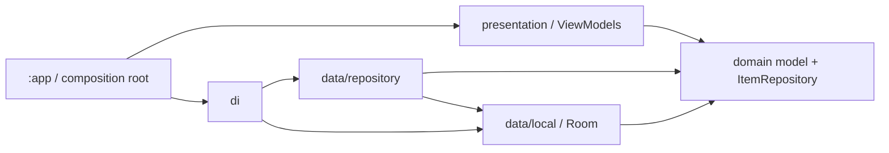
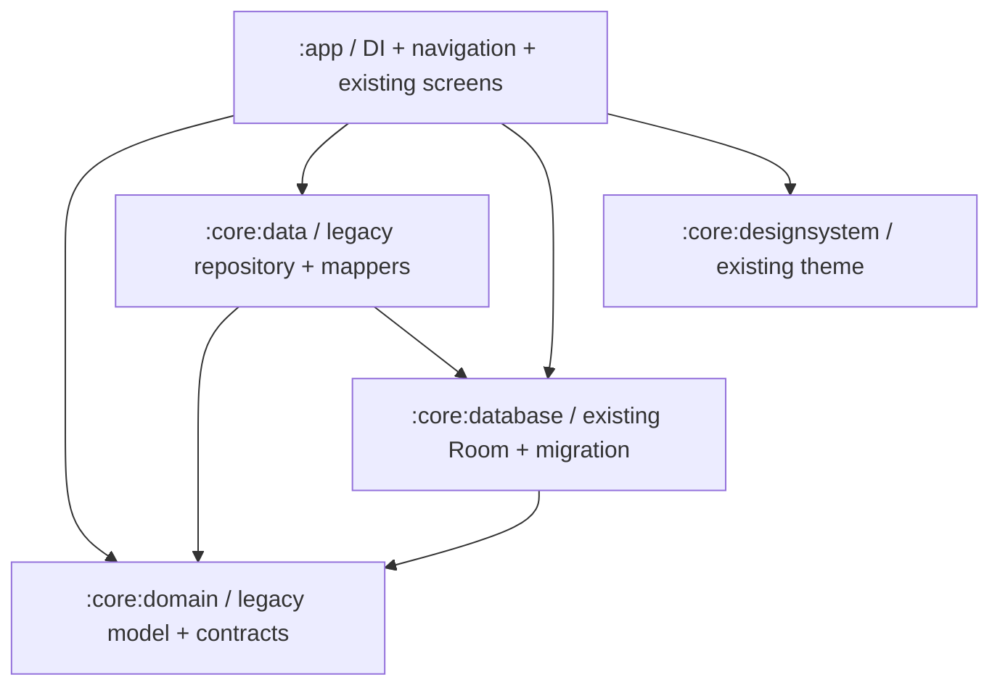
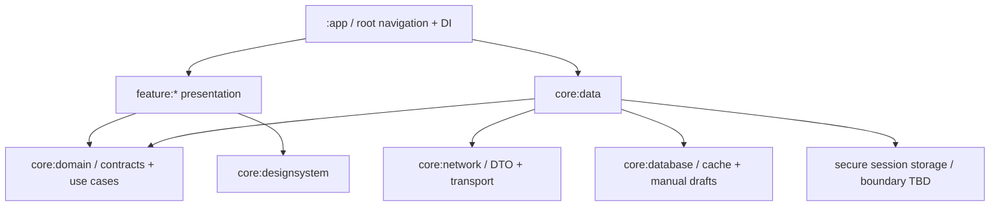
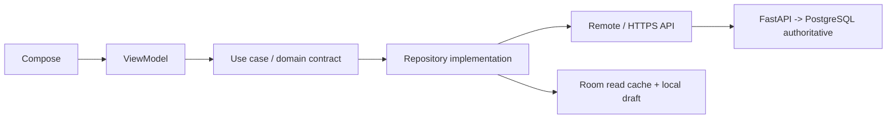

# Dependency graphs

## Hiện tại — Gradle và source

Gradle chỉ có :app; sơ đồ package dưới đây là phụ thuộc code quan sát, không phải nhiều modules.

DB->Domain hiện tồn tại do entity/converter dùng ItemStatus và mappers. Cần giữ hướng có thật khi extract, không giả vờ entity hoàn toàn độc lập.

## Phase 1 — Proposed compile dependencies

Mũi tên A->B nghĩa A import/phụ thuộc compile vào B. Tên module là đề xuất, chưa tạo.

Không có cycle: domain không phụ thuộc Android/Room/Retrofit/Compose/Hilt (Coroutines Flow được phép).
DB->Domain là thỏa hiệp chuyển tiếp giữ ItemStatus; chỉ loại bỏ sau khi có lý do rõ và test converter/migration, không đổi giá trị persisted enum để “làm sạch”.
DI modules có thể ở app trong Phase1; không để core data/database import app. Data mapper ownership cần chuyển từ entity file sang data nếu cần, giữ signature/behavior tương thích.
Designsystem không import repository, domain hoặc feature; giữ theme nguyên trạng trong lần move.
Không tạo common/model/network/datastore/ui/navigation/testing/mascot module rỗng. Feature packages giữ trong app trước; module feature tách sau khi có consumer thật.

## Mục tiêu dài hạn — Proposed boundaries, không là scope Phase1

Feature logic boundaries theo S1 §3.2: authentication, home, shopping-items, product-input, ai-conversation, cooling-off, purchases, budget, insights, settings. Không là cam kết tạo mười Gradle modules.
Nếu tách model/common/ui/mascot sau này phải có consumer và lý do, tránh shared module thành nơi gom mọi thứ.
Secure session storage không mặc định là DataStore plaintext; serializer còn Pending.

## Luồng chạy mục tiêu — không phải compile dependency

S1 §3–5, S2 §2,8, S3 §4: online response được cache; offline đọc cache có nhãn độ cũ. Official mutation chỉ xác nhận sau server. Draft/ảnh local không là outbox; reconnect không tự gửi.
Sơ đồ không mô tả backend đã chạy và không cho phép áp graph runtime làm hướng compile Domain->Data.
