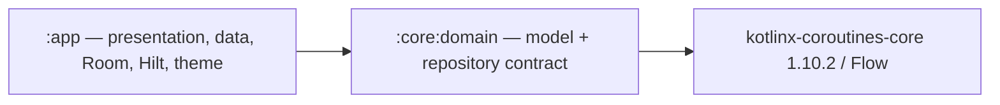

# Phase 1.1 — Domain Gradle modularization

Ngày: 18/10/2026 (Asia/Ho_Chi_Minh). Dừng sau bước 1.1 Domain của phase-0/phase-1-plan.md. Chưa commit/push.

## Điều kiện vào và phạm vi

- Đã đọc AGENTS.md, README, completion, source inventory, decisions, gap matrix, dependency graph và migration plan của Phase 0.
- Base `dev-chanko-1x` tại `26dd8d9`: merge PR #6 từ nhánh Phase 0 (`332c8ac` là ancestor); local base khớp origin tracking ref tại lúc kiểm tra. Không thực hiện merge/fetch/push; không có hồ sơ nghiệm thu độc lập ngoài bằng chứng merge PR.
- Branch mới: `feature/phase-1-1-domain-modularization`, tạo từ base trên.
- Trước sửa chỉ có PNG untracked đã được gap matrix ghi nhận; giữ nguyên. Không có tracked change.
- Phạm vi được user yêu cầu: chỉ bước nhỏ đầu tiên, tách domain. Không thực hiện bước 1.2 Database, 1.3 Data hay các bước sau.
- Bảo toàn dữ liệu local hiện hữu: không upload/chuyển đổi thành official server item; không thay schema, migration, DB filename, enum, ID, giá tiền hoặc nghiệp vụ.

## Thay đổi

- `settings.gradle.kts`: include duy nhất module mới `:core:domain`.
- Root `build.gradle.kts` và `gradle/libs.versions.toml`: khai báo Kotlin JVM plugin 2.2.10 và coroutines-core 1.10.2 theo versions hiện có; không nâng stack.
- `core/domain/build.gradle.kts`: Kotlin JVM + java-library, toolchain17. Coroutines dùng `api` vì Flow xuất hiện trong public ItemRepository contract.
- `core/domain/.gitignore`: bỏ qua build outputs của module.
- Di chuyển nguyên byte `CooldownItem.kt` (gồm ItemStatus) và `ItemRepository.kt` từ `app/src/main/java/com/hoabh/chanko/domain/` sang `core/domain/src/main/kotlin/com/hoabh/chanko/domain/`. Giữ package, API và implementation.
- `app/build.gradle.kts`: implementation(project(":core:domain")).
- Các test characterization hiện có vẫn ở app để kiểm tra consumer và ViewModel; không đổi kỳ vọng.

## Dependency graph thực tế

Domain không có project dependency ngược, không Android/Room/Hilt/Compose. Ngoài Coroutines, compileClasspath chỉ gồm Kotlin stdlib và annotations. Không cycle. `:app:dependencyInsight --dependency core:domain --configuration debugCompileClasspath` xác nhận app dùng JVM17 apiElements của module mới. Graph đề xuất trong Phase 0 vẫn là lịch sử/kế hoạch, chưa phải toàn bộ cấu trúc hiện tại.

## Verification

Baseline trước extraction:

- `:app:assembleDebug`, `:app:lintDebug`, `:app:assembleDebugAndroidTest`: BUILD SUCCESSFUL.
- `:app:testDebugUnitTest --rerun`: chạy mới 8 tests, 0 failures/errors/skipped (4 CooldownItemTest + 4 ViewModelTest).
- Lint: 0 errors, 29 warnings.

Sau extraction:

- `:app:assembleDebug :app:testDebugUnitTest :app:lintDebug :app:assembleDebugAndroidTest :core:domain:dependencies --configuration compileClasspath`: BUILD SUCCESSFUL, 95 actionable tasks executed.
- 8 tests, 0 failures/errors/skipped; test XML ghi nhận thực thi mới sau extraction.
- Lint: 0 errors, 31 warnings. So với baseline chỉ thêm hai NewerVersionAvailable cho khai báo Kotlin JVM và coroutines-core mới; giữ versions hiện có.
- `:app:dependencyInsight --dependency core:domain --configuration debugCompileClasspath`: BUILD SUCCESSFUL.
- So sánh byte với Git HEAD: cả hai file domain không đổi nội dung. Không sửa tracked app source/resource/test khác, do đó Room/migrations/DI/theme/navigation vẫn nguyên trạng.
- `git diff --check`: sạch.
- `adb devices`: không có device/emulator. AndroidTest APK đã build; connected tests, migration/DAO runtime và smoke UI/restart countdown chưa chạy, không tuyên bố pass.

## Rủi ro và điểm review

- Build/unit/lint không thay thế kiểm thử thiết bị; cần device/emulator để hoàn tất smoke/migration runtime.
- TECH-04 và các Pending trong Phase 0 vẫn giữ nguyên; không chốt env/serializer/auth/legacy account mapping.
- Legacy cooling-off và savings behavior vẫn như trước, kể cả các gap đã ghi nhận; extraction không giải quyết các gap nghiệp vụ.
- Cần review/accept bước 1.1 và quyết định bước tiếp theo riêng. Không có quyết định kỹ thuật mới bắt buộc chốt cho extraction đã hoàn thành.
- Chưa commit, push, tạo PR hoặc chuyển sang bước 1.2/1.3.
