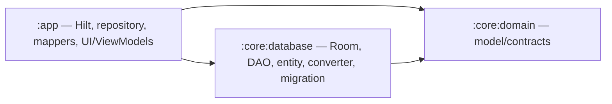

# Phase 1.2 — Database Modularization completion

Ngày: 18/10/2026 (Asia/Ho_Chi_Minh). Branch: `feature/phase-1-2-database-modularization`. Dừng trước commit/push/PR/merge.

## Review Phase 1.1 và điều kiện vào

- Đã đọc AGENTS.md ở repo thật, Phase 0 README, source inventory, decisions, migration plan, dependency graph và Phase 1.1 completion. Snapshot Phase 0 là lịch sử; chỉ thực hiện extraction được user yêu cầu, không triển khai các mục Proposed/Pending khác.
- Review branch `feature/phase-1-1-domain-modularization` tại `b463d46` so với base `26dd8d9`: hai domain files rename 100%, so sánh byte xác nhận không đổi; package/API giữ nguyên. Gradle chỉ thêm Kotlin JVM domain, coroutines API theo versions hiện có và dependency app -> domain.
- Phase 1.1 đã tích hợp qua merge commit `492950d6a0be3d6b491a663038b8828aee77f314` (PR #7, parents `26dd8d9` và `b463d46`). Tree của merge giống tree feature. Local `dev-chanko-1x` và stored ref `origin/dev-chanko-1x` cùng commit khi bắt đầu; không fetch và không khẳng định trạng thái remote mới hơn các ref local. Agent không thực hiện merge.
- Chạy lại baseline trên tree đã merge: assembleDebug, testDebugUnitTest, lintDebug, assembleDebugAndroidTest với `--rerun-tasks`, tất cả thành công; 8/8 tests pass, 0 lint errors, 31 warnings. So với baseline 29 ở trước Phase 1.1: báo cáo cũ ghi hai NewerVersionAvailable; baseline trực tiếp cho lần này là 31.
- Tạo feature branch từ `dev-chanko-1x` tại `492950d`. Ban đầu không có tracked changes, chỉ ảnh PNG untracked có sẵn; giữ nguyên ảnh. Không thay synced project sources.

## Thay đổi và bảo toàn

- Chỉ thêm module `:core:database`: Android library AGP cùng version 9.4.1, Kotlin tích hợp của AGP, Java/toolchain17, compileSdk37, minSdk24, KSP Room compiler cùng version cũ. Không upgrade dependency.
- Chuyển AppDatabase (bao gồm MIGRATION_1_2), ItemDao, Converters sang module mới nguyên byte; chuyển entity class nguyên nội dung annotation/fields. Public Kotlin package/API giữ nguyên `com.hoabh.chanko.data.local...`; namespace Android library mới chỉ dành cho module, không đổi class packages.
- Hai mapper giữ nguyên body/signature trong app tại file `data/local/entity/CooldownItemEntity.kt` cũ, giữ cả JVM facade `CooldownItemEntityKt`. Entity class thuộc database; mapper/implementation repository, Hilt DatabaseModule/RepositoryModule, UI/ViewModels và tests vẫn ở app.
- App thêm dependency database, chuyển Room KSP compiler sang database. App giữ Room runtime cho DI và existing instrumented tests, Room ktx hiện hữu không đổi.
- Database `api(domain)` vì public entity/DAO dùng ItemStatus, `api(room-runtime)` vì AppDatabase kế thừa RoomDatabase; Room ktx là implementation. Database không import app/Hilt/UI/repository implementation.
- Giữ version2, exportSchema=false, migration1->2 SQL, bảng/cột, Long VND, enum persisted, filename `chanko_database`, Hilt scope/builder/addMigrations; không thêm fallback destructive hay schema export mới.
- Không thay nghiệp vụ cooling-off/savings, auth/network/online-first, UI hay module khác.

## Dependency graph thực tế

Gradle dependencies và dependencyInsight xác nhận graph trên. Domain compileClasspath chỉ Kotlin stdlib/annotations và coroutines, không framework Android/Room/Hilt. Không có cycle hoặc core -> app. Phase 0 graph vẫn là snapshot/kế hoạch lịch sử.

## Verification sau extraction

- `:app:assembleDebug :app:testDebugUnitTest :app:lintDebug :app:assembleDebugAndroidTest :core:database:lintDebug --rerun-tasks`: BUILD SUCCESSFUL.
- 8 tests (4 CooldownItemTest + 4 ViewModelTest), 0 failures/errors/skipped; giữ nguyên existing tests.
- Lint app: 0 errors, 31 warnings; database: 0 errors, 0 warnings. Phân loại app giống baseline: GradleDependency13, UnusedResources9, NewerVersionAvailable5, MonochromeLauncherIcon2, AndroidGradlePluginVersion1, PluralsCandidate1. Không nâng version để xử lý cảnh báo.
- Generated `AppDatabase_Impl.kt` và `ItemDao_Impl.kt` so với baseline giống nguyên byte: schema identity, create/validate schema và DAO SQL không đổi. Đây là bằng chứng static/build, không thay thế runtime migration test.
- So sánh source xác nhận AppDatabase/migration, DAO, converter nguyên byte; entity declaration và mapper bodies giữ nguyên. Domain không thay đổi so với base; DI/repository/UI/tests không sửa.
- `git diff --check`: sạch. QA logs, counters và byte comparisons trong `phase-1-2-qa/`.
- `adb devices` chạy ngoài sandbox: không có device/emulator kết nối. AndroidTest APK đã build, chưa thực thi instrumented tests.

## Rủi ro và việc còn pending

- Pending: chạy ItemDatabaseTest (migration bảo toàn record/VND/status và DAO decision atomic) trên device/emulator; chạy smoke Splash/Dashboard/Add/Detail/Decision/Vault, back stack, restart/countdown và validation/error/retry, xác minh mở DB đã tồn tại sau nâng APK. Không tuyên bố runtime/smoke pass.
- Existing legacy business gaps trong Phase 0 giữ nguyên; TECH-04, serializer/auth/ownership và các Pending khác chưa được giải quyết ở extraction này.
- Không thay schema nên không cần migration version mới; nếu có regression, hoàn tác extraction code trên feature branch và giữ nguyên dữ liệu người dùng, không xóa database.
- Báo cáo Phase 1.1 ghi “chưa commit/push” là snapshot tại thời điểm viết; lịch sử merge PR #7 là bằng chứng tích hợp hiện tại.
- Không commit/push/tạo PR/merge ở lượt này. Bước tiếp theo là review diff và completion; cần chỉ thị rõ trước các hành động Git đó. Không tiếp tục Phase 1.3.
