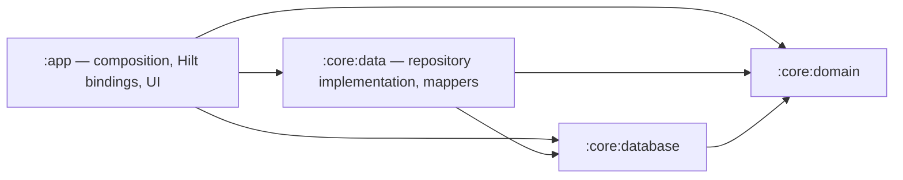

# Phase 1.3 — Data Layer Modularization completion

Ngày: 18/10/2026 (Asia/Ho_Chi_Minh). Branch: `feature/phase-1-3-data-modularization`.
Base: `dev-chanko-1x` tại `dc33400ac1403c7a7637471be9e07e889623920e`.
Trạng thái: hoàn tất extraction/build verification, dừng trước commit/push/PR/merge để review.

## Review Phase 1.2 và điều kiện vào

- Đã đọc AGENTS.md, Phase 0 README/source inventory/decisions/plan và Phase 1.2 completion; chỉ thực hiện phạm vi extraction do user yêu cầu. Các quyết định Proposed/Pending khác không được triển khai.
- Phase 1.2 đã merge qua PR #8: `dc33400` có parents `492950d` và `623d9cf`. Đã fetch origin/dev-chanko-1x; remote ref trùng base. Agent không commit/push/merge Phase 1.2.
- Review diff `492950d..dc33400`: tách database, Gradle và tài liệu đúng phạm vi. AppDatabase, DAO, converter rename 100%; entity fields/annotations và mapper bodies giữ nguyên; Hilt/repository/UI không thay đổi. Không phát hiện vấn đề chặn Phase 1.3.
- Smoke Phase 1.2 OK theo xác nhận của user, không phải agent trực tiếp chạy. Báo cáo cũ ghi chưa merge/pending smoke là snapshot lịch sử. Migration/DAO runtime chưa có bằng chứng pass.
- Baseline assembleDebug/testDebugUnitTest/lint/assembleDebugAndroidTest thành công; 8 unit tests, 0 lint errors/31 warnings. Giữ nguyên PNG untracked có sẵn và sources synced.

## Khảo sát và thay đổi

- Domain sở hữu ItemRepository contract và CooldownItem/ItemStatus. Database sở hữu Room AppDatabase, ItemDao, entity, converter, MIGRATION_1_2. Repository implementation gọi DAO, map Flow/entity, giữ validations và System.currentTimeMillis hiện hữu.
- Chuyển `app/src/main/java/com/hoabh/chanko/data/repository/ItemRepositoryImpl.kt` sang cùng package/path bên dưới `core/data/src/main/java/`, nguyên byte.
- Chuyển file mapper `app/src/main/java/com/hoabh/chanko/data/local/entity/CooldownItemEntity.kt` sang cùng package/path bên dưới `core/data/src/main/java/`, nguyên byte; giữ JVM facade CooldownItemEntityKt. Entity class vẫn ở database.
- Thêm `core/data/build.gradle.kts`, `core/data/.gitignore`; đăng ký `:core:data` trong settings.gradle.kts và thêm app implementation(data). Không stage files.
- Data là Android library dùng cấu hình SDK/Java và versions hiện có, Hilt/KSP xử lý @Inject constructor. Không thêm binding/module DI mới: DatabaseModule và RepositoryModule ở app làm composition root, giữ scope và builder nguyên trạng.
- Data dùng api(domain/database) vì public constructor/mapper signatures lộ các kiểu đó; coroutines và Hilt là implementation, Hilt compiler là ksp. Không đổi public visibility để che API hiện hữu.

## Dependency graph thực tế

Gradle resolved classpaths trong phase-1-3-qa/dependencies.log xác nhận graph; kiểm tra traversal không cycle, không core -> app. Domain chỉ Kotlin/coroutines/annotations, không Android/Room/Hilt.

## Verification

- Baseline: `:app:assembleDebug :app:testDebugUnitTest :app:lint :app:assembleDebugAndroidTest` thành công.
- Sau extraction: cùng bốn tasks cộng `:core:data:lint :core:database:lint --rerun-tasks`: BUILD SUCCESSFUL, 180 tasks executed. Hilt app compilation/linking và AndroidTest APK build thành công.
- Unit tests: 8/8 pass, không failures/errors/skipped; tests hiện hữu không sửa.
- Lint: app 0 errors/31 warnings, data 0/0, database 0/0. App giữ baseline: GradleDependency13, UnusedResources9, NewerVersionAvailable5, MonochromeLauncherIcon2, AndroidGradlePluginVersion1, PluralsCandidate1. Không upgrade dependency.
- Byte comparison repository/mapper: đúng nguyên byte với base; hash và kết quả nằm trong phase-1-3-qa/verification.json. Domain/database/DI/presentation/tests không thay đổi. Room schema/migrations/SQL/version/filename và UI/cooling-off được bảo toàn qua source không đổi.
- Có device Android 16; đã thử connectedDebugAndroidTest. Test runner KHÔNG thực thi tests: cài test APK lỗi SecurityException thiếu INSTALL_GRANT_RUNTIME_PERMISSIONS; log còn báo DELETE_FAILED_INTERNAL_ERROR khi gỡ test package. Gradle vẫn ghi BUILD SUCCESSFUL nên không dùng trạng thái đó để kết luận runtime pass.
- `git diff --check`: sạch. Logs baseline/build/dependencies/connected và counters được lưu cùng report.

## Rủi ro và pending

- Migration/DAO runtime vẫn pending do thiết bị từ chối cài test APK; cần cấu hình quyền cài/debug trên thiết bị rồi chạy lại. Không thay quyền bảo mật thiết bị hoặc xóa dữ liệu để vượt lỗi.
- Smoke Phase 1.3 chưa được chạy trực tiếp; xác nhận smoke của user thuộc Phase 1.2. Cần smoke build mới khi review.
- Không có networking/Retrofit/online-first/auth/redesign/features mới; các legacy business gaps giữ nguyên. Không đổi Room schema, không cần migration mới.
- Nếu regression, hoàn tác extraction trên feature branch; giữ database và dữ liệu người dùng, không reset/clean/xóa database.
- Chưa commit, push, tạo PR hoặc merge Phase 1.3. Dừng tại đây để user review.
