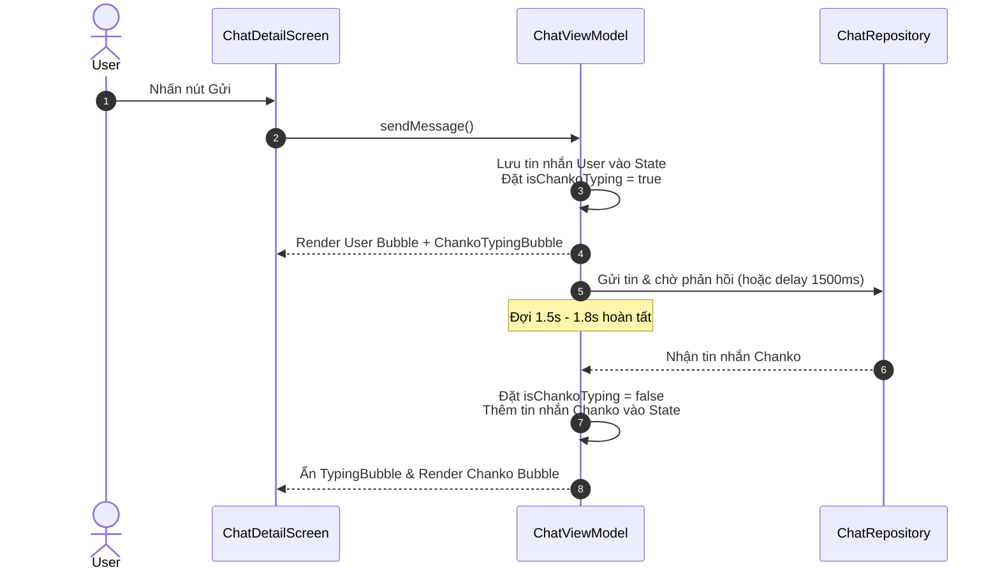

# Chanko Typing & Deliberate Response UX

## Problem Statement
Làm thế nào để tạo nhịp điệu phản hồi tự nhiên, gần gũi cho Chanko — giúp người dùng cảm nhận Chanko như một người bạn đồng hành tài chính đang thực sự "đọc, suy ngẫm và soạn câu trả lời" thay vì một cỗ máy sinh văn bản tức thì vô hồn?

---

## Recommended Direction: Bouncing Dots Typing Bubble (1.5s – 2.0s)

Xây dựng bong bóng chỉ báo đang gõ (`ChankoTypingBubble`) mang phong cách **Candy Pop 3D**:
1. **Trải nghiệm tức thời cho User:** Ngay khi nhấn Gửi, tin nhắn của người dùng xuất hiện ngay lập tức trong timeline tin nhắn, ô gõ composer được xóa trắng.
2. **Bong bóng Typing Chanko:**
   - Xuất hiện ở vị trí tin nhắn tiếp theo của Chanko (canh trái).
   - Avatar Chanko 32dp với biểu cảm suy nghĩ (`chanko_thinking`).
   - Bong bóng nền trắng, bo góc 18dp (gốc đuôi tin nhắn bo 4dp).
   - 3 chấm tròn chuyển động nảy tuần tự (Bouncing Dots Animation) màu tím thương hiệu `#8965F6`.
   - Timeline tự động cuộn xuống mượt mà để bong bóng typing luôn nằm trong tầm mắt.
3. **Thời gian suy ngẫm có chủ đích (Deliberate Thinking):**
   - Duy trì trạng thái typing trong **1.5s đến 2.0s**.
   - Sau đó, bong bóng typing biến mất và tin nhắn phản hồi chính thức (kèm thẻ nhận định Decision Card nếu có) xuất hiện với animation mượt mà.

---

## Key Assumptions to Validate
- [ ] **Nhịp điệu vừa vặn:** 1.5s – 1.8s mang lại cảm giác chân thật mà không gây sốt ruột cho người dùng khi trò chuyện liên tục.
- [ ] **Tương thích Network:** Khi tích hợp backend/AI thật, typing indicator hiển thị trong suốt thời gian network request (đảm bảo tối thiểu 1.5s nếu phản hồi quá nhanh để tránh nhấp nháy UI).
- [ ] **Cuộn mượt mà (Auto-scroll):** Không xảy ra hiện tượng giật màn hình (scroll jitter) khi bong bóng typing xuất hiện và khi tin nhắn thật thay thế nó.

---

## MVP Scope

### Trong phạm vi (In Scope):
- Component Compose `ChankoTypingBubble` với hiệu ứng 3 chấm nảy tuần tự (`InfiniteTransition`).
- Quản lý trạng thái `isChankoTyping: Boolean` trong `ChatViewModel` / `ChatUiState`.
- Delay có kiểm soát 1.5s – 1.8s trong coroutine gửi tin nhắn trước khi emit tin nhắn của Chanko.
- Tự động cuộn danh sách tin nhắn xuống cuối khi bắt đầu typing và khi tin nhắn xuất hiện.
- Hỗ trợ cả 2 chế độ: Trò chuyện tự do (FREE) và Thẩm định món đồ (ITEM).

### Ngoài phạm vi (Not Doing & Lý do):
- **Hiệu ứng gõ từng chữ (Streaming / Typewriter text):** Chưa triển khai lúc này vì làm tăng độ phức tạp render Compose, dễ gây giật layout khi tin nhắn có kèm thẻ nhận định phức tạp (`DecisionVerdictCard`).
- **Thời gian gõ động theo số lượng ký tự:** Tránh để người dùng phải chờ quá 3 giây với các câu trả lời dài. Giữ thời gian cố định 1.5s – 2.0s để đảm bảo tính nhất quán.
- **Cho phép User ngắt lời (Cancel response):** Không cần thiết trong phạm vi MVP hội thoại tài chính ngắn gọn.

---

## Technical Specifications & UI Design

### 1. Visual Design Token
- **Container:** Nền `#FFFFFF`, viền 1dp `#E4DDF2`, bo góc `RoundedCornerShape(topStart = 4.dp, topEnd = 20.dp, bottomEnd = 20.dp, bottomStart = 20.dp)`.
- **Dots:** 3 chấm tròn đường kính 7dp, màu tím `CandyColors.brandPurple` (`#8965F6`).
- **Khoảng cách:** 4dp giữa các chấm.
- **Biên độ nảy:** Di chuyển dọc từ 0dp lên -6dp với độ trễ (delay offset) giữa chấm 1, 2, 3 là 150ms.

### 2. State & Data Flow

