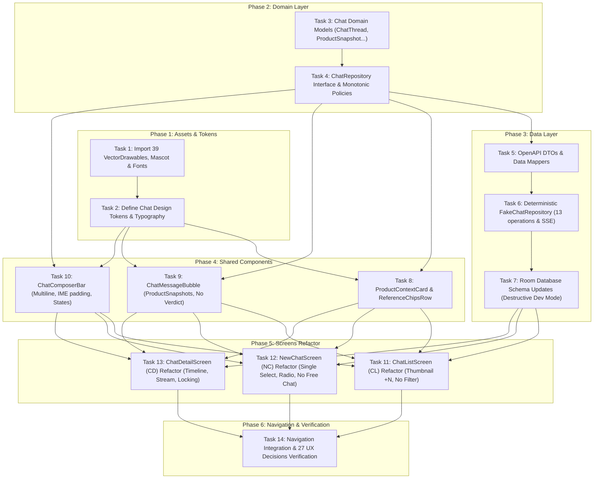

# Kế hoạch Triển khai Kỹ thuật: Chanko Chat UI v2.2 (Product-Centric Chat)

> **Tài liệu Đặc tả tham chiếu:** [SPEC-chat-ui-v2.2.md](../SPEC-chat-ui-v2.2.md) & [docs/features/chat-ui-v2.2-spec.md](../docs/features/chat-ui-v2.2-spec.md)  
> **Nguồn bàn giao:** `Chanko-Chat-UI-v2.2/` (Revision 5, 07/11/2026)  
> **Chiến lược:** Clean Architecture, Single Source of Truth (SSOT), Deterministic Fake Repository, Non-destructive UI Integration, B07 Contract Ready.  
> **Trạng thái:** SẴN SÀNG TRIỂN KHAI (Phase 2 & 3 Completed)

---

## 1. Tổng quan Kiến trúc (Overview)

Kế hoạch này triển khai nâng cấp toàn diện tính năng Chat thành **Product-Centric Chat** theo 27 quyết định UX gốc và chuẩn OpenAPI 3.0.3:
1. **Một sản phẩm chính bất biến + nhiều sản phẩm tham chiếu (`CHAT-01`, `CD-GAP-02`).** Bãi bỏ hoàn toàn Free Chat.
2. **Khách quan hóa phân tích Chanko:** Loại bỏ Decision Verdict Card (BUY/WAIT/SKIP); hiển thị `productSnapshots` phân tích khách quan cho từng sản phẩm (`CD-GAP-03`, `EDGE-11`).
3. **Loại bỏ bộ lọc trạng thái cũ:** Bãi bỏ các Filter Chips cũ trên CL và NC (`CL-GAP-02`); tích hợp widget thời gian hạ nhiệt bắt buộc **Mandatory Cooling-off** (`CD-GAP-03`).
4. **Quản lý Bản nháp & Lịch sử:** Tra cứu chat cũ khi chọn sản phẩm (`CHAT-02`, `NC-GAP-01`); bản nháp chỉ lưu ở client, không persist vào DB trước tin nhắn đầu tiên (`NC-GAP-04`, `EDGE-05`, `EDGE-06`).
5. **Độ tin cậy & Idempotency:** Gửi tin nhắn idempotent (`Idempotency-Key`, `clientMessageId`), khóa tham chiếu khi AI đang stream (`EDGE-09`), yêu cầu hủy generation trước khi lưu trữ/xóa (`EDGE-12`).
6. **Bộ tài nguyên hoàn chỉnh v2.2:** 39 VectorDrawables duotone, Mascot WebP nodpi, font tĩnh Nunito upstream, Candy Tokens v2.2.

---

## 2. Quyết định Kiến trúc & Chiến lược Kỹ thuật (Architecture Decisions)

1. **B07: Contract Ready — Deterministic Fake Repository:**
   - Triển khai `FakeChatRepository` lưu trữ in-memory theo mô hình OpenAPI 3.0.3 với 13 operations đầy đủ.
   - Giả lập luồng Server-Sent Events (SSE) phản hồi từng phần qua Kotlin `Flow<ChatGenerationEvent>`, cho phép hủy phát qua `cancelGeneration()`.
   - Giúp độc lập 100% với backend FastAPI thật, sẵn sàng chuyển đổi sang Retrofit/Ktor chỉ bằng cách thay thế binding Hilt/Koin.
2. **Room Database: Fallback Destructive Migration cho môi trường Dev:**
   - Theo chỉ đạo của người dùng, không tạo migration script phức tạp.
   - Thêm `fallbackToDestructiveMigration()` hoặc tái tạo schema Room cho `ChatThreadEntity` và `ChatMessageEntity` để lưu trữ `primaryProductId`, `referencesJson`, `productSnapshotsJson`, `readOnlyReason`.
3. **Thiết kế Component theo Clean Architecture & Jetpack Compose:**
   - Presentation layer chia thành các subpackages: `list/`, `newchat/`, `detail/`, và `components/` dùng chung.
   - Tách biệt rõ ràng Stateful Route và Stateless Screen.
   - Mọi icon, button, radio row tuân thủ touch target $\ge 48\,\text{dp}$, semantics đầy đủ cho trợ năng (Role Radio, StateDescription).
4. **Quản lý Thời gian Hạ nhiệt Monotonic:**
   - Sử dụng `SystemClock.elapsedRealtime()` để đếm ngược mượt mà, chống gian lận chỉnh giờ hệ thống.
   - Đồng bộ lại `serverNow` khi app quay lại Foreground (`LifecycleEventObserver`).

---

## 3. Sơ đồ Phụ thuộc (Dependency Graph)

---

## 4. Quản trị Rủi ro (Risks & Mitigations)

| Rủi ro | Mức độ | Biện pháp Giảm thiểu |
|---|---|---|
| Xung đột tài nguyên drawable trùng tên | Thấp | Toàn bộ icon mang prefix `chat_`, mascot mang prefix `chanko_chat_`, không trùng tài nguyên hiện có. |
| Bàn phím IME che mất Composer trên màn hình nhỏ | Trung bình | Sử dụng `Modifier.imePadding()` kết hợp `Modifier.navigationBarsPadding()` và giới hạn tối đa 6 dòng trước khi cuộn nội bộ. |
| Mất trạng thái draft khi xoay màn hình | Thấp | Quản lý state draft thông qua ViewModel `SavedStateHandle` hoặc in-memory state duy trì suốt vòng đời ViewModel. |
| Rò rỉ Coroutine khi stream SSE giả lập | Thấp | Quản lý stream trong `viewModelScope` và chủ động hủy qua `Job.cancel()` khi người dùng thoát màn hình hoặc gửi tín hiệu Cancel. |
