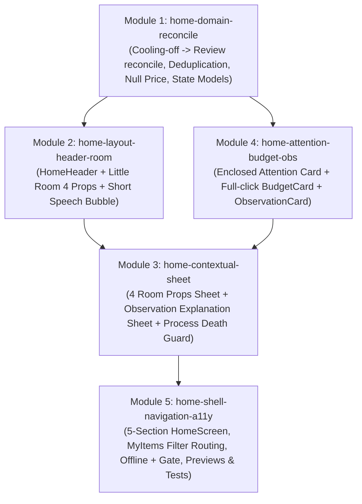

# Implementation Plan: Chanko Home UI v1.0 (Candy Pop 3D)

> **Spec tham chiếu:** [SPEC-home-ui-v1.md](../../SPEC-home-ui-v1.md) · [docs/features/home-ui-v1-spec.md](../features/home-ui-v1-spec.md)  
> **Nguồn bàn giao:** `Chanko-Home-Design-Handoff-v1.0` (22 Frozen Decisions · 22 Acceptance Criteria)  
> **Danh sách công việc (Task List Target):** [tasks/todo.md](../../tasks/todo.md) & [docs/tasks/home-ui-v1-tasks.md](../tasks/home-ui-v1-tasks.md)

---

## 1. Overview

Triển khai bản nâng cấp toàn diện màn hình **`HomeScreen`** theo chuẩn thiết kế **Candy Pop 3D v1.0** và 22 quyết định UX đã đóng băng (`HOME-REV-01`..`HOME-GAP-05`) cùng 22 tiêu chí nghiệm thu (`AC-01`..`AC-22`). Trọng tâm bao gồm:
1. Sắp xếp lại đúng thứ tự 5 khu vực nội dung (`Header → Little Room → Những món cần chú ý → Budget → Observation`) và **gỡ bỏ hoàn toàn 2 thẻ Quick Actions cũ** (`AC-01`, `AC-02`).
2. Chuẩn hóa **Little Room** với 4 vật thể tương tác (*Đang chờ*, *Cần xem lại*, *Ngân sách*, *Đã bỏ qua*), bóng thoại ngắn gọn và **Contextual Bottom Sheet** hiển thị đúng ngữ cảnh (bao gồm cả giải thích chi tiết cho *Góc nhìn từ Chanko* khi nhấn *"Giải thích thêm"*).
3. Đồng bộ hóa logic phân nhóm giữa Little Room và *Những món cần chú ý*: món hết hạn `Cooling-off` tự động chuyển sang nhóm *Cần xem lại* mà **không tự đổi verdict thành `BUY`** và **không đếm trùng `itemId`** (`AC-07`, `AC-08`).
4. Bọc khu vực *Những món cần chú ý* trong khung card sáng bo tròn lớn theo mockup mới, hiển thị tối đa 3 món ưu tiên cần hành động, xử lý giá thiếu `"Chưa có giá"` (`AC-09`, `AC-10`, `HOME-EDGE-04`).
5. Đặt `Budget Card` sau Attention với toàn bộ vùng chạm mở `BudgetScreen` và tự động cập nhật khi đổi chu kỳ (`AC-11`..`AC-13`).
6. Đảm bảo cô lập lỗi từng khu vực (`AC-15`), chế độ Offline hiển thị cache kèm thời điểm đồng bộ và chặn nút `+` không mở Add Item / không tạo draft (`AC-16`, `AC-17`), giữ vị trí cuộn khi quay lại (`AC-18`), không tự mở lại sheet sau process death (`AC-19`), đạt chuẩn trợ năng `48dp` + TalkBack (`AC-20`), tôn trọng Reduced Motion (`AC-21`) và không gây áp lực mua sắm (`AC-22`).

---

## 2. Dependency Graph & Architecture Decisions

### Các Quyết Định Kiến Trúc Cốt Lõi:
1. **Single Source of Truth cho Phân Nhóm (`HomeGroupingEngine` / `DecisionRanker`):**
   - Cả 4 badge/sheet của Little Room và danh sách 3 món trong *Những món cần chú ý* đều đọc từ cùng một kết quả phân nhóm đã reconcile thời gian `Cooling-off`.
   - Khi `status == Waiting && remainingSeconds <= 0`: món đồ được phân vào nhóm `Review` (*Cần xem lại*) với nhãn phụ `"Vừa hết thời gian chờ"`, giữ nguyên `verdict` ban đầu (không chuyển thành `BUY`), đảm bảo tổng số lượng nhất quán và không bao giờ xuất hiện ở cả 2 nhóm (`AC-07`, `AC-08`).
2. **Contextual Sheet Mở Rộng (`HomeSheet.Contextual`):**
   - Phục vụ 5 ngữ cảnh: `Hourglass` (*Đang chờ*), `Calendar` (*Cần xem lại*), `Wallet` (*Ngân sách*), `PauseJar` (*Đã bỏ qua*), và `Observation` (*Giải thích chi tiết Góc nhìn từ Chanko*).
   - Lưu giữ `activeSheet` thuần túy trong bộ nhớ của `HomeViewModel` (không lưu vào `SavedStateHandle` hay `rememberSaveable`), trong khi `LazyListState` của `HomeScreen` được giữ qua `rememberLazyListState()`. Nhờ đó, khi điều hướng đi và quay lại thì vị trí cuộn được bảo toàn (`AC-18`), còn khi Android hủy tiến trình (process death) thì sheet luôn đóng (`AC-19`).
3. **Liên Kết Bộ Lọc `MyItems` Từ Home (`AC-06`):**
   - Truyền yêu cầu lọc từ `HomeRoute` qua `MainNavigation` đến `MyItemsViewModel`:
     - *Đang chờ* $\rightarrow$ `PrimaryFilter.ACTIVE` + `ActiveSubFilter.COOLING_OFF`
     - *Cần xem lại* $\rightarrow$ `PrimaryFilter.ACTIVE` + `ActiveSubFilter.READY`
     - *Đã bỏ qua* $\rightarrow$ `PrimaryFilter.SKIPPED` + `ActiveSubFilter.ALL_ACTIVE`
     - *Tất cả ›* $\rightarrow$ `PrimaryFilter.ALL` + `ActiveSubFilter.ALL_ACTIVE`
4. **Cổng Kiểm Soát Ngoại Tuyến (Offline Network Gate — `AC-16`, `AC-17`):**
   - Khi `isOffline == true`, `HomeHeader` hiển thị huy hiệu ngoại tuyến kèm thời điểm đồng bộ thực tế (`lastSyncedAtText`).
   - Nhấn nút `+` trên `ChankoBottomBar` khi offline sẽ phát thông báo yêu cầu kết nối mạng (Snackbar) và chặn hoàn toàn việc mở `AddItemViewModel::open`, tuyệt đối không tạo bản nháp (draft).

---

## 3. Task List

### Phase 1: Foundation & Domain Reconciliation (`home-domain-reconcile`)
- [x] **Task 1:** Nâng cấp Domain Logic, State Model & Reconcile Cooling-off (`AC-07`, `AC-08`, `AC-09`, `AC-11`, `HOME-EDGE-04`)
- [x] **Task 2:** Cập nhật `HomeFakeDataSource`, `HomeViewModel` & Bộ Unit Test Domain/ViewModel (`AC-01`..`AC-19`)

### Checkpoint 1: Foundation & Domain
- [x] Toàn bộ unit tests cho `HomeDomainLogicTest` và `HomeViewModelTest` chạy PASS (`./gradlew :app:testDevDebugUnitTest`).

### Phase 2: Core UI Components & Contextual Sheet (`home-layout-header-room`, `home-attention-budget-obs`, `home-contextual-sheet`)
- [x] **Task 3:** Cập nhật `HomeHeader`, `CompactLivingRoom` & Strings theo chuẩn Candy Pop 3D v1.0 (`AC-03`, `AC-04`, `AC-16`, `AC-20`, `AC-21`)
- [x] **Task 4:** Cập nhật `YourDecisionsSection` (Khung Card Bao Ngoài), `BudgetCard` & `ObservationCard` (`AC-09`..`AC-14`, `AC-22`)
- [x] **Task 5:** Cập nhật `HomeSheetHost` (Contextual Sheet 4 Vật Thể + Giải Thích Insight) & Tái cấu trúc `HomeScreen` 5 Khu Vực (`AC-01`, `AC-02`, `AC-05`, `AC-06`, `AC-19`)

### Checkpoint 2: Core UI Components
- [x] Mã nguồn UI biên dịch thành công (`./gradlew :app:compileDevDebugKotlin`), không còn `QuickActionsRow`, thứ tự 5 khu vực khớp tuyệt đối với AC-01.

### Phase 3: Navigation Shell, Offline Gate & Verification (`home-shell-navigation-a11y`)
- [x] **Task 6:** Kết nối Điều hướng `HomeRoute`, `MainNavigation` (Bộ lọc `MyItems`, `ItemDetail`) & Chặn Nút `+` Khi Offline (`AC-06`, `AC-10`, `AC-17`, `AC-18`)
- [x] **Task 7:** Hoàn thiện Responsive Previews & Chạy Kiểm Thử Toàn Diện Nghiệm Thu 22 AC (`AC-01`..`AC-22`)

### Checkpoint 3: Complete
- [x] Tất cả 22 Acceptance Criteria (`AC-01`..`AC-22`) vượt qua kiểm thử, build `assembleDevDebug` và `testDevDebugUnitTest` xanh 100%.

---

## 4. Risks and Mitigations

| Rủi ro | Mức độ | Biện pháp giảm thiểu |
| :--- | :---: | :--- |
| Lệch số lượng giữa badge trong Little Room và danh sách *Những món cần chú ý* tại thời điểm hết hạn `Cooling-off` | Cao | Sử dụng duy nhất 1 hàm reconcile trong `HomeDomainLogic` tạo ra cả danh sách nhóm (`waitingItems`, `reviewItems`, `skippedItems`) và `topAttentionItems` từ cùng 1 danh sách đầu vào. |
| TalkBack đọc lặp 2 lần trên `BudgetCard` (vừa đọc card vừa đọc nút `"Chi tiết ›"`) hoặc trên vật thể Little Room | Trung bình | Áp dụng `clickable` duy nhất ở container cha với `semantics(mergeDescendants = true)`; nút `"Chi tiết ›"` và badge số lượng chỉ là thành phần hiển thị thị giác bên trong, không gắn `clickable` riêng (`AC-12`, `AC-20`). |
| Vùng chạm của 4 vật thể trong Little Room bị chồng lấn hoặc nhỏ hơn `48dp` trên màn hình hẹp `320dp` | Trung bình | Bố trí 4 cột hotspot độc lập (`weight(1f)`), mỗi hotspot có `sizeIn(minWidth = 48.dp, minHeight = 48.dp)` bao gồm cả hình vật thể và pill nhãn bên dưới theo hướng dẫn tại `RESPONSIVE-COMPOSE.md`. |
| Contextual Sheet tự mở lại sau khi Android hủy tiến trình (process death) | Trung bình | Giữ `activeSheet` trong `MutableStateFlow` in-memory của `HomeViewModel` với giá trị khởi tạo `null`, không lưu vào `SavedStateHandle` hay `rememberSaveable` (`AC-19`). |

---

## 5. Open Questions

- Không còn câu hỏi mở (toàn bộ Capability Map, 5 giả định kỹ thuật và phương án mở Contextual Sheet cho nút *"Giải thích thêm"* đã được người dùng phê duyệt).
