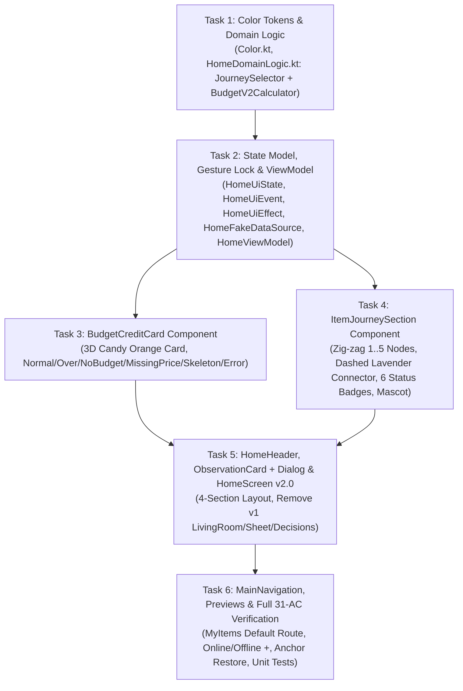

# Implementation Plan: Chanko Home UI v2.0 (Budget Credit Card & Item Journey)

> **Spec tham chiếu:** [SPEC-home-ui-v2.md](../../SPEC-home-ui-v2.md) · [docs/features/home-ui-v2-spec.md](../features/home-ui-v2-spec.md)  
> **Nguồn bàn giao:** `Chanko_Home_v2.0_Handoff` (31 Acceptance Criteria `AC-01`..`AC-31` · 23 State Matrix rows · `reference/home-v2-approved.png`)  
> **Task List Target:** [tasks/todo.md](../../tasks/todo.md) & [docs/tasks/home-ui-v2-tasks.md](../tasks/home-ui-v2-tasks.md)

---

## 1. Overview

Triển khai toàn diện màn hình **HomeScreen v2.0** theo đặc tả đã phê duyệt tại [docs/features/home-ui-v2-spec.md](../features/home-ui-v2-spec.md), thay thế hoàn toàn kiến trúc Little Room + 4 vật thể + Contextual Sheet + danh sách *Những món cần chú ý* của v1.0 bằng cấu trúc **4 khu vực cuộn (`Header → Budget Credit Card → Item Journey → Observation`)**:
1. **`HomeHeader`**: Lời chào theo buổi + phụ đề *"Hôm nay mình cùng cân nhắc nhé!"* + nút Avatar tròn mở `Profile & Settings` gộp + huy hiệu Offline kèm `syncedAt` (`AC-02`, `AC-20`).
2. **`BudgetCreditCard`**: Thẻ tín dụng mua sắm **3D Candy Orange (`#FFB665` / `#F59145`)** với logo dấu chân + `CHANKO SHOPPING BUDGET`, chip vàng, sóng contactless, mèo trắng ló đầu trang trí, số tiền *Ngân sách còn lại* `32sp ExtraBold`, thanh tiến trình capsule (`0..1`) + pill `%`, dòng *Đã chi / tổng ngân sách* (bao gồm cả `Pay Now` & `Credit`) và khoảng ngày chu kỳ; giữ nền cam khi vượt hạn mức kèm cảnh báo màu **Coral (`#B83248`)**; hỗ trợ đầy đủ `NoBudget`, `MissingPrice` (*"Chưa đủ dữ liệu giá"*), `Skeleton`, `Error + Retry cục bộ`, `OfflineCache` và `OfflineNoCache` (`AC-03`..`AC-09`, `AC-18`..`AC-22`).
3. **`ItemJourneySection` (*"Món đồ gần đây"*)**: Hiển thị $\min(n, 5)$ món đồ mới nhất sau khi lọc bỏ `Archived` (`createdAt DESC`, tie-break `itemId ASC`, đổi `status` không đổi thứ tự — `AC-10`, `AC-11`, `AC-12`); các node tròn `80–96dp` xếp ziczac dọc bên trái nối bằng $n - 1$ đoạn nét đứt lavender (`#BDA8EB`), mỗi node có ảnh sản phẩm + viền màu + badge icon góc trên phải cho đủ **6 trạng thái** (`Saved`, `Considering`, `Waiting`, `Ready`, `Purchased`, `Skipped` — `AC-13`, `AC-14`); chạm node mở trực tiếp `ItemDetailScreen(itemId)` (`AC-15`), chạm *"Xem tất cả ›"* mở `MyItems` mặc định (`AC-16`); 1 mascot Chanko canonical đứng bên phải cuộn cùng Journey (`AC-17`).
4. **`ObservationCard` (*"Góc nhìn từ Chanko"*)**: Thẻ có mèo Chanko góc trái dưới + icon bóng đèn + nhận xét + nút mũi tên `>` mở `InsightExplanationDialog` + nút ẩn bền vững theo `insightId`; bỏ hoàn toàn vùng và khoảng trống khi không có dữ liệu (`AC-26`, `AC-27`).
5. **Điều hướng, Đồng bộ Gesture-Safe & Trợ năng (`AC-23`..`AC-25`, `AC-28`..`AC-31`)**: Khóa snapshot `itemId` từ `pointer-down` đến `click/cancel`, bảo toàn vị trí cuộn & anchor hợp lệ qua back/process death, chặn nút `+` khi offline, và đảm bảo tương thích `320dp`, `fontScale = 2.0f`, TalkBack và Reduced Motion.

---

## 2. Dependency Graph & Architecture Decisions

---

## 3. Task List

### Phase 1: Foundation, Tokens & Domain/State Engine (`home-v2-domain-state`)
- [x] **Task 1:** Bổ sung Semantic Color Tokens v2.0 (`Color.kt`), Strings (`strings_home.xml`) & Domain Logic (`JourneySelector` + `BudgetV2Calculator` trong `HomeDomainLogic.kt`) (`AC-03`, `AC-06`..`AC-12`, `AC-25`)
- [x] **Task 2:** Nâng cấp `HomeUiState`, `HomeUiEvent`, `HomeUiEffect`, `HomeFakeDataSource` & `HomeViewModel` (SectionState độc lập, Gesture Snapshot Lock, Offline Cache/NoCache, Insight Hide) + Unit Tests (`AC-08`, `AC-18`..`AC-27`, `AC-30`)

### Checkpoint 1: Foundation & Domain/ViewModel Tests
- [x] Toàn bộ unit tests cho `HomeDomainLogicTest`, `HomeViewModelTest` và `ColorArchitectureTest` chạy PASS (`./gradlew :app:testDevDebugUnitTest`).

### Phase 2: Core v2.0 UI Components (`home-v2-budget-credit-card`, `home-v2-item-journey`)
- [x] **Task 3:** Xây dựng `BudgetCreditCard.kt` 3D Candy Orange với đầy đủ trạng thái (`Normal`, `OverBudget` Coral, `NoBudget`, `MissingPrice`, `Skeleton`, `Error + Retry`, `OfflineNoCache`) (`AC-03`..`AC-09`, `AC-18`..`AC-22`, `AC-31`)
- [x] **Task 4:** Xây dựng `ItemJourneySection.kt` (*"Món đồ gần đây"*): Ziczac 1..5 Nodes tròn `80–96dp`, Đường nối nét đứt Lavender, 6 Status Badges, Mascot bên phải & Gesture-Safe Touch (`AC-10`..`AC-17`, `AC-23`, `AC-24`, `AC-31`)

### Checkpoint 2: Core v2.0 Components
- [x] Các component mới biên dịch sạch sẽ (`./gradlew :app:compileDevDebugKotlin`), tuân thủ tuyệt đối `ColorArchitectureTest`.

### Phase 3: Header, Observation, HomeScreen Assembly & Navigation (`home-v2-header-observation-shell`)
- [x] **Task 5:** Cập nhật `HomeHeader.kt`, `ObservationCard.kt` (kèm `InsightExplanationDialog`), lắp ghép `HomeScreen.kt` 4 khu vực chuẩn v2.0 và xóa bỏ `CompactLivingRoom.kt`, `YourDecisionsSection.kt`, `HomeSheetHost.kt`, `BudgetCard.kt` cũ (`AC-01`, `AC-02`, `AC-26`, `AC-27`)
- [x] **Task 6:** Kết nối `MainNavigation.kt`, Hoàn thiện bộ Responsive Previews v2.0 & Kiểm thử Nghiệm thu Toàn diện 31 AC (`AC-15`, `AC-16`, `AC-28`..`AC-31`)

### Checkpoint 3: Complete & Ready for Review
- [x] Tất cả 31 Acceptance Criteria (`AC-01`..`AC-31`) vượt qua kiểm thử, `./gradlew :app:testDevDebugUnitTest` và `./gradlew :app:assembleDevDebug` xanh 100%.
