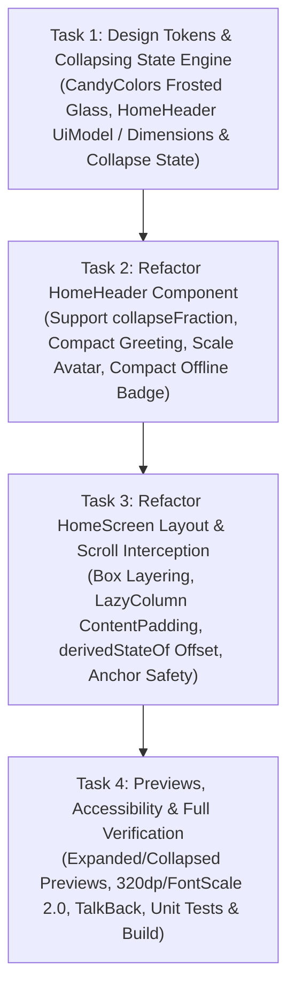

# Implementation Plan: Sticky & Collapsing Home Header

> **Spec & Ý tưởng tham chiếu:** [docs/ideas/sticky-collapsing-home-header.md](../ideas/sticky-collapsing-home-header.md)  
> **Nguồn baseline:** `HomeScreen.kt` & `HomeHeader.kt` (Chanko Home v2.0 · `AC-01`, `AC-02`, `AC-20`, `AC-31`)  
> **Task List Target:** [docs/tasks/sticky-collapsing-home-header-tasks.md](../tasks/sticky-collapsing-home-header-tasks.md)

---

## 1. Overview

Nâng cấp trải nghiệm cuộn tại màn hình chính (`HomeScreen`) của Chanko:
Hiện tại `HomeHeader` nằm bên trong `LazyColumn` nên khi người dùng cuộn xem thẻ ngân sách (`BudgetCreditCard`) và hành trình món đồ (`ItemJourneySection`), phần Header bị cuộn trôi mất.
Kế hoạch này tách `HomeHeader` ra thành một thanh điều hướng cố định phía trên (`Sticky Top Bar`), áp dụng hiệu ứng **Collapsing mượt mà (co giãn theo scroll offset)** kết hợp **nền kính mờ (Frosted glass)** và **duy trì chỉ báo ngoại tuyến (Offline Indicator)** ở cả hai trạng thái mở rộng và thu gọn:
- **Expanded (Đỉnh trang):** Lời chào buổi + Subtitle + Avatar kích thước chuẩn 52dp + Banner ngoại tuyến đầy đủ (khi offline).
- **Collapsed (Khi cuộn xuống):** Header co gọn thành thanh mỏng (~56dp + status bar), mờ dần subtitle, giữ lời chào ngắn gọn + Avatar thu nhỏ (~38dp) + chỉ báo ngoại tuyến mini, nền kính mờ chống rối chữ khi các card trôi ngầm bên dưới.

---

## 2. Dependency Graph & Architecture Decisions

### Các Quyết Định Kiến Trúc Cốt Lõi:

1. **Tách Header khỏi `LazyColumn` qua cơ chế Box Layering:**
   - Đặt `HomeScreen` trong một `BoxWithConstraints` (hoặc `Box`), trong đó `LazyColumn` nằm ở lớp nền (`zIndex = 0`) và `HomeHeader` nổi ở lớp trên (`zIndex = 1f`, `Alignment.TopCenter`).
   - `LazyColumn` có `clipToPadding = false` để khi người dùng cuộn nội dung lên, các card trượt ngầm phía sau Header và tràn lên vùng status bar mà không bị cắt cụt đột ngột.
   - `contentPadding.top` của `LazyColumn` được tính bằng `statusBarTopPadding + expandedHeaderHeight + CandySpace.md`, đảm bảo ở vị trí đỉnh (`scrollOffset == 0`), thẻ đầu tiên nằm ngay sát mép dưới của Header.

2. **Tính toán `collapseFraction` không gây Recomposition bão hòa (`derivedStateOf`):**
   - Sử dụng `derivedStateOf` lắng nghe `listState.firstVisibleItemIndex` và `listState.firstVisibleItemScrollOffset` để chuẩn hóa tỷ lệ co giãn $f \in [0.0, 1.0]$.
   - Mọi biến đổi về `alpha`, `scale`, `translationY` được thực hiện qua `graphicsLayer` để chạy trên RenderThread, tránh kích hoạt recomposition toàn màn hình khi người dùng vuốt nhanh.

3. **Bảo toàn khả năng đọc & Trợ năng (Accessibility & Legibility):**
   - Khi $f > 0.0$, nền Header kích hoạt màu kính mờ (`CandyColors.homeScreenBackgroundTop` có alpha $\approx 0.92..0.96$) kết hợp đổ bóng mỏng hoặc border divider mảnh để thẻ màu cam đậm `BudgetCreditCard` không làm rối chữ trên Header.
   - Huy hiệu ngoại tuyến khi thu gọn co thành badge/icon cạnh Avatar, nhưng TalkBack semantics vẫn đọc rõ ràng: *"Trạng thái: Ngoại tuyến, chạm để xem chi tiết đồng bộ"*.
   - Khả năng bấm Avatar để mở Profile & Settings (`HomeUiEvent.AvatarTap`) hoạt động ổn định và chính xác ở cả 2 trạng thái.

---

## 3. Task List

### Phase 1: Foundation & Header Component
- [ ] **Task 1:** Bổ sung Design Tokens kính mờ, kích thước chuẩn & hàm tính toán `collapseFraction`
- [ ] **Task 2:** Tái cấu trúc `HomeHeader.kt` hỗ trợ trạng thái co giãn (`collapseFraction`), thu nhỏ Avatar và chỉ báo Offline mini

### Checkpoint 1: Header Foundation
- [ ] `HomeHeader` render độc lập mượt mà ở cả 2 trạng thái `collapseFraction = 0f` và `1f` trong Compose Preview.
- [ ] Kiểm thử biên dịch `./gradlew :app:compileDevDebugKotlin` sạch sẽ.

### Phase 2: HomeScreen Layering & Responsive Verification
- [ ] **Task 3:** Cập nhật `HomeScreen.kt` để ghim Header cố định, kết nối `derivedStateOf` cuộn và đệm lề an toàn
- [ ] **Task 4:** Bổ sung Previews mở rộng/thu gọn, kiểm thử trợ năng TalkBack, FontScale 2.0f và chạy Full Verification

### Checkpoint 2: Hoàn tất & Nghiệm thu
- [ ] Header ghim cố định và co giãn mượt mà khi cuộn trên `HomeScreen`.
- [ ] Thẻ Budget Card và Item Journey cuộn êm bên dưới lớp kính mờ.
- [ ] Toàn bộ unit tests `./gradlew :app:testDevDebugUnitTest` PASS và `./gradlew :app:assembleDevDebug` BUILD SUCCESSFUL.

---

## 4. Risks and Mitigations

| Rủi ro | Mức độ | Biện pháp giảm thiểu |
| :--- | :---: | :--- |
| Tụt khung hình (Jank/FPS drop) khi cuộn do recomposition liên tục tại Header | Cao | Sử dụng `derivedStateOf` với ngưỡng làm tròn hợp lý hoặc dùng `graphicsLayer` lambda (`alpha = { ... }`, `translationY = { ... }`) để render biến đổi trên RenderNode thay vì re-layout. |
| Chiều cao Header bị cố định cứng làm tràn chữ khi người dùng phóng to font (`fontScale = 2.0f`) | Trung bình | Sử dụng `heightIn` linh hoạt hoặc đo kích thước động bằng `onGloballyPositioned` để xác định chiều cao mở rộng thực tế trước khi nội suy `collapseFraction`. |
| Danh sách `LazyColumn` bị che mất phần đầu hoặc giật nảy khi chuyển trạng thái | Trung bình | Đặt `contentPadding.top` chuẩn xác theo chiều cao mở rộng; không chèn Spacer động làm thay đổi chiều dài danh sách của LazyColumn. |
| Mất chỉ báo ngoại tuyến khi thu gọn làm người dùng nhầm lẫn về dữ liệu | Thấp | Tích hợp badge offline mini có màu cảnh báo ngay cạnh nút Avatar trong thanh thu gọn. |

---

## 5. Open Questions & Resolutions
- **Q:** Khi click vào badge ngoại tuyến ở thanh thu gọn thì thế nào?  
  **A:** Hiển thị Snackbar hoặc mở thông báo nhắc nhở thời điểm đồng bộ lần cuối như ở bản đầy đủ.
