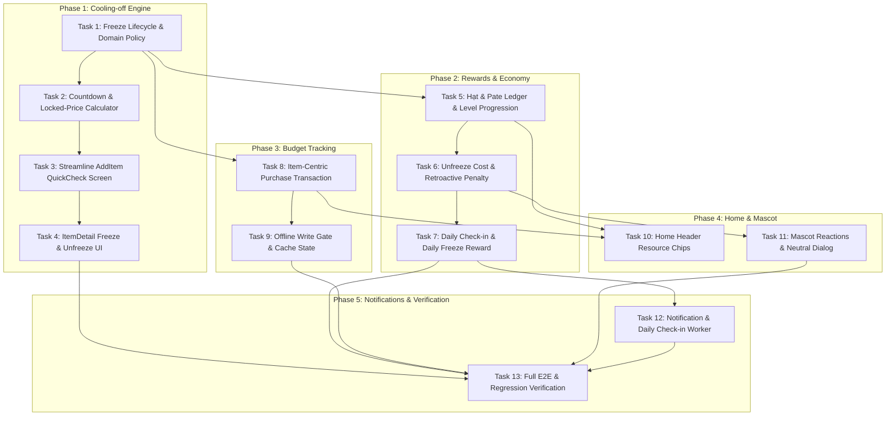

# Implementation Plan: Chanko Core Ecosystem (Cooling-off, Rewards, Mascot Economy, Budget Tracking & Notifications)

> **Spec & Bản đồ Năng lực tham chiếu:** [CAPABILITY-MAP-chanko-core.md](../CAPABILITY-MAP-chanko-core.md)  
> **Nguồn quyết định đã chốt:** Cập nhật ngày 07/11/2026 (Phạm vi 1–7 và danh mục thông số mở 8).  
> **Chiến lược kiến trúc:** Domain-Driven, Offline-Safe, Unidirectional Data Flow, Non-destructive UI integration.

---

## 1. Overview (Tổng quan Triển khai)

Kế hoạch này triển khai trọn vẹn 5 năng lực cốt lõi theo các quyết định đã chốt ngày 07/11/2026:
1. **Luồng mua sắm & Cooling-off:** Mọi sản phẩm sau Quick Check bắt buộc trải qua Freeze do Chanko ấn định thời gian; hết hạn chuyển sang *"Sẵn sàng xem xét"*; cho phép Unfreeze sớm chịu phí và Freeze lại không trùng thưởng.
2. **Hệ kinh tế Rewards:** Giới thiệu **Hạt** (Resource) và **Pate** (EXP); Daily Check-in cố định không streak multiplier; thưởng Freeze theo giá (tối đa 1 lần/ngày); số dư không âm.
3. **Phạt Unfreeze & Thu hồi hồi tố:** Chi phí phạt Unfreeze sớm tỷ lệ theo $\text{Giá} \times \frac{t_{\text{còn}}}{T_{\text{tổng}}}$; mua khi đang Freeze tính như Unfreeze sớm; thu hồi thưởng và phạt hồi tố nếu khai báo mua muộn kèm audit trail.
4. **Mascot Economy tự động (MASCOT-FEEDING = A):** Hạt và Pate tự động cộng; Chanko tự lên cấp theo Pate; Level không bao giờ tụt; không chỉ số đói, không phán xét.
5. **Tích hợp Home & Mascot:** TopBar hiển thị Hạt, Pate, Level; Mascot biểu cảm vui vẻ khi thưởng/lên cấp và trung lập khi Unfreeze; giữ nguyên Budget Carousel và Item Journey.
6. **Budget Tracking theo sản phẩm:** Chỉ trừ ngân sách khi người dùng xác nhận đã mua sản phẩm đã thêm vào app; hỗ trợ Pay Now và Thẻ tín dụng; hỗ trợ hoàn tiền; chặn ghi khi ngoại tuyến.
7. **Thông báo chủ động & Daily Email:** Kênh hỏi người dùng đã mua sản phẩm chưa, nhắc check-in, báo hết freeze, báo nhận thưởng và email tổng hợp.

---

## 2. Architecture Decisions (Quyết định Kiến trúc Cốt lõi)

1. **Chính sách Linh hoạt cho các Thông số Mở (Policy & Config Abstraction):**
   - Các thông số chưa khóa hoàn toàn (REWARD-01..07, NOTI-01..02, CHECKIN-01) được đóng gói trong `RewardsEconomyConfig` và `FreezePolicy` dạng inject được, có giá trị mặc định hợp lý (10 Hạt/Pate check-in, Freeze 1/3/7/14 ngày, ngưỡng level lũy tiến). Nhờ đó code sẵn sàng chạy ngay và có thể tinh chỉnh config mà không sửa logic lõi.
2. **Khóa Giá & Mốc Thời gian Tuyệt đối (Epoch-based State Machine):**
   - Giá được khóa cứng (`lockedPrice`) ngay khi bắt đầu Freeze.
   - Thời gian Freeze căn cứ vào `freezeStartedAtMillis` và `freezeDurationMillis` (Epoch UTC). Trạng thái hết hạn được tính toán tự động `now >= freezeEndMillis`, đảm bảo tính đúng đắn kể cả khi app tắt.
3. **Sổ Cái Tài nguyên Bất Biến & Chống Âm (Non-Negative Clamped Ledger):**
   - Tài khoản Hạt/Pate hoạt động theo mô hình Transaction Ledger ghi nhận: `CHECKIN_REWARD`, `FREEZE_REWARD`, `EARLY_UNFREEZE_FEE`, `RETROACTIVE_CLAWBACK`.
   - Phép trừ Hạt/Pate bị chặn sàn tại 0 (`balance.coerceAtLeast(0)`), vẫn cho phép người dùng Unfreeze khi không đủ tài nguyên. Level của Chanko là monotonic non-decreasing (chỉ tăng, không tụt).
4. **Tách biệt Ngân sách VNĐ và Tài nguyên Hạt/Pate:**
   - Budget Tracking chỉ hạch toán VNĐ cho các giao dịch mua hàng thực tế của các sản phẩm có trong Chanko.
   - Không có sự pha trộn giữa VNĐ và Hạt/Pate.
5. **Offline Safety & Write Gate:**
   - Khi mất mạng, toàn bộ dữ liệu (Hạt, Pate, Freeze items, Budget) hiển thị từ local Room/cache.
   - Mọi thao tác ghi hoặc thay đổi trạng thái (xác nhận mua, unfreeze, ghi nhận budget) đều qua cổng kiểm tra kết nối mạng và chặn ghi bằng thông báo tiếng Việt nếu ngoại tuyến.

---

## 3. Dependency Graph & Phase Breakdown

---

## 4. Phase Overview & Verification Checkpoints

- **Phase 1: Foundation — Cooling-off Engine & Shopping Flow** (Tasks 1–4)
  - *Checkpoint 1:* Vòng đời Freeze bắt buộc, đếm ngược và chuyển sang "Sẵn sàng xem xét" hoàn toàn xanh test.
- **Phase 2: Core Economy — Rewards, Ledger & Retroactive Clawback** (Tasks 5–7)
  - *Checkpoint 2:* Hạt/Pate không âm, công thức phạt Unfreeze chuẩn xác, thưởng tối đa 1 lần/ngày.
- **Phase 3: Integration — Item-Centric Budget Tracking & Offline Guard** (Tasks 8–9)
  - *Checkpoint 3:* Mua đồ trừ ngân sách chuẩn VNĐ, hỗ trợ Pay Now/Credit, chặn ghi ngoại tuyến.
- **Phase 4: Experience — Home Header & Mascot Interaction** (Tasks 10–11)
  - *Checkpoint 4:* Hiển thị Hạt, Pate, Level trên TopBar; Mascot phản ứng biểu cảm trung thực và không phán xét.
- **Phase 5: Proactive Engagement & Final Verification** (Tasks 12–13)
  - *Checkpoint 5:* Điều phối thông báo và kiểm thử hồi quy toàn diện đạt 100% build và unit tests.

---

## 5. Risks & Mitigation Strategies

| Rủi ro (Risk) | Mức độ | Biện pháp giảm thiểu (Mitigation) |
| :--- | :---: | :--- |
| Mua muộn hoặc mua offline dẫn đến gian lận thưởng | Trung bình | Cơ chế audit log và `RetroactivePurchaseHandler` tự động truy thu thưởng và tính phí phạt tại thời điểm mua thực tế. |
| Người dùng thiếu Hạt/Pate không thể Unfreeze | Thấp | Đã chốt quy tắc: Clamping số dư tại 0 (`coerceAtLeast(0)`), không cản trở hành vi Unfreeze của người dùng. |
| Xung đột hiển thị trên Home Screen v2.2 | Thấp | Tích hợp số dư Hạt/Pate gọn gàng vào TopBar/Header, bảo toàn nguyên vẹn `BudgetCreditCardCarousel` và `ItemJourneySection`. |
| Thông số kinh tế cần điều chỉnh sau thử nghiệm | Thấp | Tập trung toàn bộ thông số vào `RewardsEconomyConfig` dạng cấu hình tập trung. |
